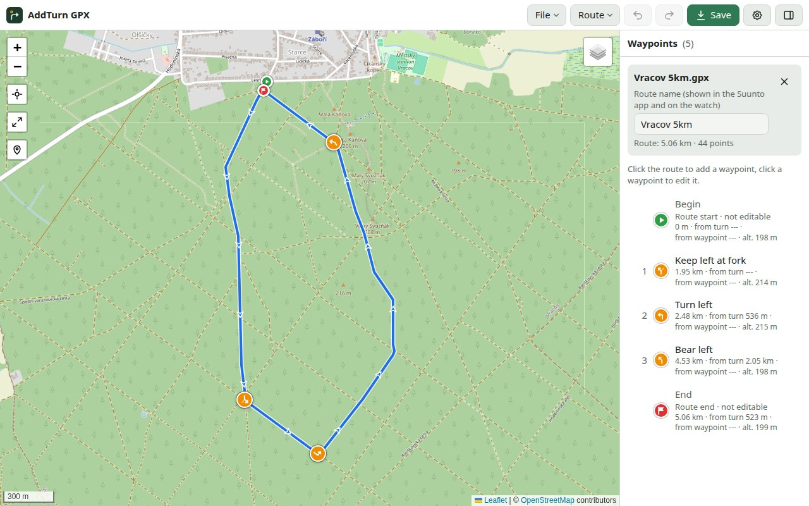
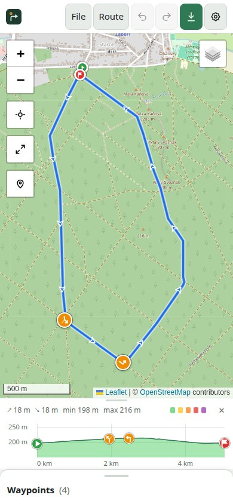
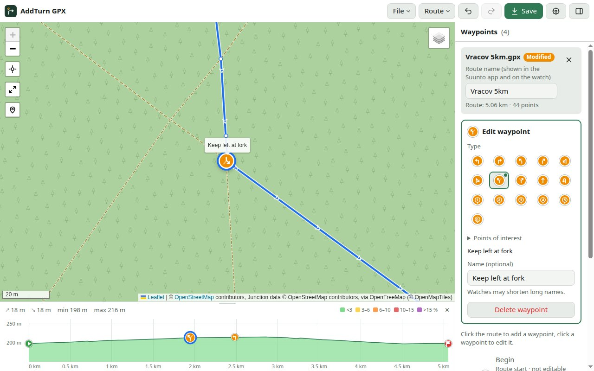
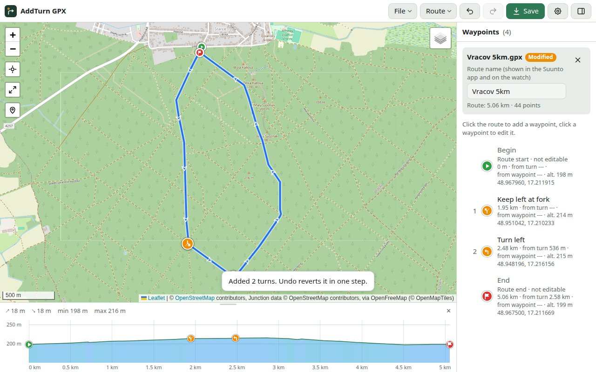
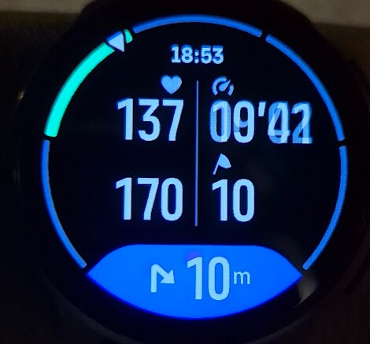

# AddTurn GPX

English version: [README.md](README.md)

**Varování!!!**

1. Testuji pouze na Suunto Race 2
2. Na firmware 2.56.28 se mi doposud nepodařilo najít postup, který spolehlivě vede k tomu, aby hodinky ukazovaly vzdálenost k další odbočce. V tomto firmware je více chyb a cesta k úspěchu spočívá v přesně daném postupu plánování trasy. V podstatě se mi podařilo jen jednou dosáhnout toho, že pole "Vzdálenost k dalšímu POI/Waypointu" ukazovala správně vzdálenost. Bohužel jsem si nepoznamenal nastavení a od té doby nejsem schopen tento pokus zopakovat. Vím pouze, že to jde, ale netuším, jak. Počet kombinací je velmi velký...

Aplikace: <https://dushino.github.io/addturngpx/>

AddTurn GPX přidává do tras GPX navigační pokyny pro **hodinky Suunto**. Běží celá v prohlížeči, bez serveru a bez registrace.

Hodinky Suunto při navigaci po trase ukazují pokyn (odboč vlevo, na rozcestí vpravo…) a vzdálenost k němu. Dělají to ale jen u waypointů, které splňují přísné podmínky. Většina souborů GPX, včetně souborů z jiných plánovačů, tak skončí úplně bez pokynů. V AddTurn GPX si trasu otevřeš, pokyny přidáš ručně nebo je necháš vygenerovat automaticky na skutečných křižovatkách a uložíš soubor, který aplikace Suunto správně načte. Soubor se vždy uloží ve formátu exportu ze Suunto Routeplanneru (viz [Formát souboru](#formát-souboru)).

*Trasa s odbočkami, které přidalo **Route → Generate turns**: jejich ikony na mapě a v panelu seznam waypointů se vzdáleností od startu, od předchozí odbočky, nadmořskou výškou a souřadnicemi.*

## Doporučený postup (ověřeno na hodinkách)

**Aplikace Suunto → sdílený odkaz → stažený soubor GPX → AddTurn GPX → import do aplikace Suunto**

Tenhle postup je vyzkoušený na skutečných hodinkách, s dřívějším formátem souboru: hodinky ukazovaly každý pokyn s jeho ikonou a vzdálenost k dalšímu. Trasy odjinud (třeba GPX export přímo ze Suunto Routeplanneru nebo z jiných plánovačů) se při otevření převedou. Tenhle převod ale zatím na hodinkách vyzkoušený není. Uložený soubor má teď formát Suunto Routeplanneru, který na hodinkách zatím vyzkoušený také není (viz [Formát souboru](#formát-souboru)).

1. **Naplánuj trasu v aplikaci Suunto** (nebo ji naplánuj v Suunto Routeplanneru a ulož do svého účtu Suunto, aby se objevila v aplikaci).
2. **V aplikaci Suunto trasu nasdílej.** Dostaneš odkaz ve tvaru `https://api.sports-tracker.com/apiserver/v2/routes/export/…?brand=SUUNTOAPP&format=gpx-route`.
3. **Odkaz otevři v prohlížeči** – stáhne trasu jako soubor `.gpx` – **a soubor otevři v AddTurn GPX** přes **File → Open** (na Androidu i *Sdílet* → *AddTurn GPX*). Aplikace ho převede (viz [Formát souboru](#formát-souboru)).
4. **Přidej pokyny:** zvol **Route → Generate turns**; odbočky se přidají hned (jedno Undo je vrátí). Nebo je přidej sám kliknutím na trasu.
5. **Klikni na Save.** Body trasy zůstanou tak, jak je aplikace Suunto vyexportovala; soubor se uloží ve [formátu Suunto Routeplanneru](#formát-souboru).
6. **Uložený soubor naimportuj do aplikace Suunto** jako trasu a synchronizuj do hodinek.
7. **Nenaviguj trasu pozpátku** (viz [Na hodinkách](#na-hodinkách)).

## Otevření trasy

- **File → Open**: vyber soubor `.gpx` v zařízení. Na počítači ho můžeš také přetáhnout do okna.
- **Sdílení na Androidu**: ve správci souborů vyber soubor `.gpx` a zvol *Sdílet* → *AddTurn GPX*. Je k tomu potřeba [nainstalovaná aplikace](#instalace-na-telefon-a-provoz-offline). V seznamu *Otevřít v aplikaci* ukazuje Android jen nativní aplikace, takže tam AddTurn GPX být nemůže. Sdílet jde vždy jen jeden soubor.
- **Otevřít v aplikaci na počítači**: pokud máš aplikaci nainstalovanou z Chrome nebo Edge, klikni na soubor `.gpx` pravým tlačítkem a zvol *Otevřít v programu* → *AddTurn GPX*. Prohlížeč se poprvé zeptá na povolení.

Aplikace si pamatuje otevřený soubor i neuložené úpravy, takže zavřením záložky nebo obnovením stránky o práci nepřijdeš.

## Plánování nové trasy

**File → New route** naplánuje trasu na mapě: ty umístíš body a [GraphHopper](https://www.graphhopper.com) mezi nimi najde cestu po skutečných cestách. Nepotřebuješ to, když už trasu máš v aplikaci Suunto nebo v souboru GPX.

Hledání cesty potřebuje **tvůj vlastní bezplatný API klíč**. Získáš ho za pár minut:

1. Založ si bezplatný účet na [graphhopper.com](https://graphhopper.com/dashboard/signup).
2. V dashboardu otevři [API Keys](https://graphhopper.com/dashboard/api-keys) a zkopíruj klíč.
3. V AddTurn GPX zvol **File → New route** a klíč vlož. Aplikace si ho zapamatuje v tomto prohlížeči. Změníš nebo smažeš ho v **Settings** (ozubené kolo v horní liště).

Pak naplánuj trasu:

- **Foot** nebo **Bike** nastaví profil. Platí pro další přidané body, takže jedna trasa může kombinovat obojí.
- **Přidání bodu**: klikni (nebo klepni) do mapy. První bod je start.
- **Úprava trasy na počítači**: bod posuneš tažením, smažeš kliknutím a tažením čáry přidáš bod mezi dva stávající.
- **Úprava trasy na telefonu nebo tabletu**: bod posuneš tažením prstem. Nebo na něj klepni a pak klepni do mapy, kam se má přesunout, případně na **Remove** v liště nahoře. Bod mezi dva stávající přidáš dlouhým stiskem čáry.
- **Back to start** přidá cestu zpět k prvnímu bodu, když chceš uzavřít okruh.
- **Undo** a **Redo** fungují pro všechny tyto úpravy. V panelu vidíš délku, stoupání a klesání. Rozpracovaná trasa přežije obnovení stránky.
- **Finish** vytvoří trasu a vrátí tě k běžným úpravám: přejmenuj trasu, přidej odbočky přes Generate turns a ulož. Zpět do plánování se potom už nedostaneš.

Dobré vědět:

- Bezplatný plán GraphHopperu je jen pro **nekomerční použití**, dává 500 kreditů denně a má limit za minutu. Přidání bodu stojí obvykle 1 kredit, posun nejvýš 2 a Undo nic. Když narazíš na minutový limit, aplikace počká a pokračuje sama.
- Soubor prochází stejným převodem jako soubory z jiných plánovačů, takže na hodinkách zatím není vyzkoušený (viz [Doporučený postup](#doporučený-postup-ověřeno-na-hodinkách)).

## Obrazovka

- **Mapa**: trasa se šipkami ve směru jízdy a waypointy. Tlačítka vlevo přibližují a oddalují, ukážou tvou polohu (ikona zmodrá, dalším klepnutím poloha zmizí) a **⤢ Fit route** ukáže celou trasu, i tu právě plánovanou. Tlačítko se **špendlíkem** pod nimi (nebo **Ctrl+G**) je **Go to** (přejít na): zadej souřadnice – desetinné jako `45.7661, 6.8385` (i `45.7661N, 6.8385E`), nebo stupně, minuty a vteřiny jako `45°45'58"N 6°50'18"E` či `N 45° 45.966' E 6° 50.309'` – nebo vzdálenost po otevřené trase v km, jak ji ukazuje seznam waypointů (`67.28` nebo `67.28 km`). Mapa místo přiblíží a označí kroužkem, který zmizí po kliknutí do mapy nebo Esc; waypoint do 5 m od místa se vybere. Tlačítkem vrstev vpravo přepínáš mezi **OpenStreetMap**, **OpenTopoMap** (turistická mapa s vrstevnicemi) a **Satellite (Esri)**. Vlevo dole je měřítko v metrech.
- **Panel** (na počítači vpravo, na telefonu vysouvací panel dole): údaje o souboru, **název trasy**, který ukáže aplikace Suunto a hodinky (můžeš ho kdykoli upravit; Zpět funguje jako u ostatních úprav), a seznam waypointů v pořadí, v jakém na ně na trase narazíš. U každého waypointu: vzdálenost od startu po trase, od předchozí odbočky, od předchozího waypointu, který není odbočka (bod zájmu, Crossroads, obecný waypoint; *---*, když žádný není), a nadmořská výška a pod tím jeho **souřadnice** (šířka, délka, např. `48.957771, 17.209697`) – stejný zápis, jaký přijímá **Go to**. Waypoint mimo trasu ukáže jen výšku a souřadnice.
- **Lišta**: menu **File** (New route, Open, Save, Save as…, Export FIT, Close) a **Route** (Snap to roads, Generate turns, Edit route, Reverse route), dál Undo, Redo, Save, Settings a tlačítko, které panel ukáže nebo skryje. Položky, které právě použít nejde (třeba Route bez otevřené trasy), jsou šedé; *Save as…* je jen v prohlížečích, které umí vybrat, kam uložit (Chrome a Edge na počítači). Na telefonu mají tlačítka kromě menu jen ikony. Název (nebo ikona) aplikace vlevo otevře tuto stránku projektu na GitHubu.

Když aplikace pracuje, ukazuje kurzor myši přesýpací hodiny: při otevírání souboru a při výpočtu Generate turns nebo Snap to roads (u dlouhé trasy to chvíli trvá); malé hodiny vedle šipky, když čeká na data z internetu (stahování dat cest pro Generate turns a Snap to roads, plánování trasy, Follow roads) a mapou můžeš dál posouvat.

Rozložení se přizpůsobí obrazovce (počítač, tablet, telefon) a ovládání se řídí světlým nebo tmavým režimem systému. Samotná mapa zůstává vždy světlá.

## Barvy a ikony

| Značka | Význam |
| --- | --- |
| Oranžové kolečko se šipkou | Pokyn k odbočení. Šipka je natočená podle směru příjezdu, takže „odboč vpravo“ ukazuje doprava tak, jak to uvidíš v terénu. |
| Oranžové kolečko s kroužkem a číslem | Kruhový objezd, číslo je výjezd |
| Modré kolečko se symbolem | Bod zájmu – voda a moře (voda, zdroj vody, řeka, jezero, vodopád, pláž…) |
| Zelené kolečko se symbolem | Bod zájmu – příroda, terén a zvěř (les, vrchol, jeskyně, houby, zvěř, místo k rybaření…) |
| Hnědé kolečko se symbolem | Bod zájmu – jídlo a nocleh (kavárna, restaurace, hotel, tábořiště, ohniště…) |
| Tyrkysové kolečko se symbolem | Bod zájmu – orientace a doprava (informace, vyhlídka, parkoviště, silnice, stezka, křižovatka, geocache) |
| Červené kolečko se symbolem | Bezpečnost: nebezpečí, lavina, nouze, občerstvovací stanice |
| Fialové kolečko se špendlíkem | Obecný waypoint (bez typu nebo s typem, který hodinky neznají) |
| Zelené **▶** / červená **vlaječka** | *Begin* a *End* – začátek a konec trasy, jak je nazývá Suunto. Zobrazují se, ale needitují. |
| Šedá s červeným okrajem a červeným **!** | **Waypoint neleží na bodu trasy, a Suunto ho proto ignoruje** – i když na mapě vypadá, že na čáře trasy leží. Seznam červeně ukáže jeho vzdálenost od trasy, panel řekne, kolik takových waypointů je, a editor nabídne tlačítko *Snap to the route*, které ho přesune na nejbližší místo na čáře trasy (a vloží tam bod trasy, je-li potřeba). Waypointy blízko trasy se na ni přesunou už při otevření souboru (viz *Otevírání souborů*). |
| Červená čára trasy | Část trasy, kterou **Snap to roads** nedokázalo přichytit k cestě v mapě (viz *Přichycení zaznamenané trasy k cestám*). |
| Modrý obrys, mírně zvětšený | Vybraný waypoint (ponechá si barvu svého typu) |
| Malé, mírně potlačené tyrkysové kolečko | Waypoint *Crossroads* vytvořený tlačítkem **Generate turns** (viz *Automatické pokyny*). Leží pod ostatními značkami. |
| Malý tyrkysový odznak na odbočce | Vygenerovaný waypoint *Crossroads* leží na stejném místě jako tato odbočka (*Crossroads in advance* 0 m). Vybrat ho jde v seznamu. |
| Tmavě šedé kolečko s číslem | Víc waypointů na stejném místě (třeba odbočka a občerstvení, nebo dva průchody trasy tam a zpět). Číslo říká kolik. Kliknutím se rozbalí (viz níže). |

**Víc waypointů na jednom místě.** Po kliknutí na tmavé kolečko vedou z místa čáry k malým panelům s ikonou každého waypointu: dva tvoří V (1 vlevo, 2 vpravo), tři a víc kruh s 1 nahoře, dál po směru hodinových ručiček v pořadí po trase. Když se nevejdou, kruh se zvětší. Vede-li trasa místem víckrát, je na panelu i číslo průchodu. Kliknutím na panel se waypoint otevře v editoru, tažením se přesune. Výběr některého z nich v seznamu místo rozbalí samo. Klik jinam do mapy, Esc, zavření editoru nebo výběr jiného waypointu ho zase sbalí.

Všech 78 typů waypointů, které Suunto zná, má vlastní ikonu. V editoru jsou body zájmu seřazené do stejných skupin. Další upozornění v seznamu:

- **Neznámý typ**: Suunto waypoint ukáže jako obecný *Waypoint*.
- **Více tras v jednom souboru**: Suunto každou naimportuje jako samostatnou trasu.

## Úpravy trasy

**Route → Edit route** umožní změnit čáru každé otevřené trasy, i té naplánované v aplikaci po *Finish*:

- **Počítač**: bod trasy posuneš tažením, nebo na něj klikni (vybereš ho) a pak klikni do mapy, kam se má přesunout. **Remove** v liště nahoře (nebo klávesa Delete) vybraný bod smaže; samotný klik nic nemaže. Tažením čáry vložíš nový bod.
- **Telefon nebo tablet**: bod trasy táhni prstem, nebo na něj klepni a pak klepni do mapy, kam se má přesunout. **Remove** v liště nahoře vybraný bod smaže. Dlouhým stiskem čáry vložíš bod na čáru; zůstane vybraný, takže ho klepnutím do mapy hned přesuneš.
- **Follow roads** (výchozí zapnuto) najde cestu po silnicích a cestách přes GraphHopper s tvým API klíčem (viz [Plánování nové trasy](#plánování-nové-trasy)) a profilem **Foot** / **Bike**. Posun, vložení nebo smazání bodu přeplánuje trasu od předchozího po následující waypoint (odbočka, bod zájmu, Begin, End), nejdál 500 m na každou stranu; zbytek trasy zůstane, jak je. Body, které jsi v Edit route posunul nebo vložil, a body naklikané při plánování trasy v aplikaci jsou **průchozí body** (na mapě plné): přeplánování se o ně zastaví stejně jako o waypoint, takže pozdější úprava v okolí tu dřívější nezruší. Pamatují se k otevřenému souboru v tomto prohlížeči (ne v GPX). Každá změna stojí zhruba 1 kredit. Odbočky na upravovaném bodu zmizí, body zájmu na něm se přichytí na nejbližší bod nové trasy (do 50 m, jinak zmizí). Aplikace řekne, co se stalo.
- S vypnutým **Follow roads** vede mezi body rovná čára (hodí se pro cestu, která v OpenStreetMap není). Waypointy na posunutém bodu se posunou s ním (Suunto je potřebuje na bodu trasy) a se smazaným bodem zmizí. Posunutý bod si ponechá výšku.
- Begin a End zůstanou na prvním a posledním bodu.
- Odbočky jinde se neaktualizují. Po úpravách stiskni znovu **Generate turns**.
- **Done** (nebo Esc) úpravy ukončí. Každá změna je jeden krok Undo.

### Obrácení trasy

**Route → Reverse route** obrátí směr trasy, třeba když chceš okruh běžet opačně:

- Body trasy půjdou v opačném pořadí, Begin a End se přesunou na nové konce. Body zájmu zůstanou na svých místech, i tam, kudy trasa vede víckrát (z prvního průchodu se stane poslední).
- Má-li trasa odbočky (vygenerované i přidané ručně) nebo vygenerované waypointy *Crossroads*, vytvoří se znovu pro nový směr, stejně jako po **Generate turns**. Data o cestách už bývají uložená, takže se obvykle nic nestahuje. Když je načíst nejde (bez internetu a nic uloženého), trasa se neobrátí.
- Název trasy dostane na konec ` reversed` (*Vracov 5km* → *Vracov 5km reversed*); další obrácení ho odebere, ale jen když název končí přesně takhle.
- **Save** pak uloží do nového souboru (pojmenovaného podle trasy), takže původní soubor se nepřepíše.
- Undo vrátí celé obrácení i s odbočkami jedním krokem.

## Úpravy waypointů

- **Přidání**: klikni (nebo klepni) na čáru trasy tam, kde ještě žádný waypoint není. Nový waypoint se přichytí k nejbližšímu bodu trasy a otevře se jeho editor.
  - Když v místě kliknutí žádný bod trasy není (dlouhý rovný úsek), aplikace vloží nový bod trasy přesně na čáru. Tvar trasy se nezmění.
  - Typ se navrhne podle stejných pravidel jako u Generate turns: podle tvaru křižovatky, když jsou data o cestách pro trasu uložená v prohlížeči, jinak jen podle úhlu trasy. Kde pokyn není potřeba, navrhne *Straight on*. Když je vybraný waypoint s typem bodu zájmu (třeba *Water point*), nový dostane stejný typ, takže jich rychle přidáš víc.
  - S myší kurzor ukazuje, co kliknutí udělá: **kříž** nad trasou (přidá waypoint), **ukazováček** u waypointu (vybere ho) a otevřená ruka jinde (tažením posuneš mapu).
- **Úprava**: klikni na waypoint na mapě (nebo těsně vedle něj) či v seznamu a otevře se editor. Kliknutím do prázdného místa mapy nebo klávesou Esc editor zavřeš.
  - **Type (typ)**: nahoře pokyny k odbočení a kruhové objezdy, pod *Points of interest* body zájmu. Zelená tečka označuje navržený typ.
  - **Name (název)** je nepovinný. Hodinky mohou dlouhé názvy zkrátit. Každá nová odbočka dostane jako název text pokynu, například *Bear right*, ať ji přidáš ručně, nebo generátorem. Při změně typu se tento text změní s ním. Název, který napíšeš sám, zůstane.
  - **Delete waypoint** smaže waypoint, s potvrzením.
- **Tažení**: značku můžeš na počítači přetáhnout myší. Po puštění se přichytí na trasu.
- **Místo, kudy trasa vede víckrát** (trasa tam a zpět, odbočka tam a zpět): když tam waypoint přidáš nebo přetáhneš, aplikace se zeptá, **ke kterému průchodu** patří – každé tlačítko ukazuje pořadí, vzdálenost od startu a šipku směru jízdy a mapa zvýrazní posledních 80 m trasy před místem na daném průchodu. Editor waypointu na takovém místě má řádek **Pass**, kterým ho přesuneš na jiný průchod. Suunto přiřazuje waypoint k trase podle souřadnic, takže průchod se pozná podle pořadí waypointů v souboru; kde pořadí nestačí (mezi průchody žádný waypoint), dostane waypoint vlastní bod trasy 1 m před místem na zvoleném průchodu. Tvar trasy se nezmění.
- **Undo / Redo**: každou úpravu jde vrátit, i automatické generování jedním krokem.
- **Modified** u názvu souboru znamená, že změny ještě nejsou uložené do souboru. Aplikace se zeptá, než soubor zavřeš nebo otevřeš jiný.

## Přichycení zaznamenané trasy k cestám

Trasa zaznamenaná GPS přístrojem nebo hodinkami (třeba oficiální GPX závodu) neleží přesně na cestách mapy: vede pár metrů vedle nich a na křižovatkách zkracuje rohy. **Generate turns** pak odbočky vynechá, protože pokyn dává jen na křižovatku, kterou trasa projíždí. Napraví to **Route → Snap to roads**:

- Stáhne stejná data o cestách z OpenStreetMap jako Generate turns (to je pak už nestahuje) a najde, kudy vede celá trasa po mapě, ne bod po bodu, takže trasa na křižovatce neskočí na příčnou cestu ani na vedlejší rameno serpentiny.
- Přichycené části se nahradí tvarem cest, přes každou křižovatku a ohyb. Výška zůstane ze záznamu. Waypointy na trase se posunou se svými body.
- Části dál než **25 m** od jakékoli cesty (pěšina, která v mapě není, nebo záznam, který ujel) zůstanou, jak byly, a jsou **červené**. Panel ukáže jejich délku. Opravit je můžeš ručně v **Edit route**; upravená část zmodrá.
- Jedno **Undo** to vrátí. Když soubor uložíš a později ho přichytíš znovu, části už na cestách zůstanou, jak jsou, a červené budou jen ty, které se přichytit nepodařilo.
- **Settings → Snap to roads**: *Snap the route to roads when a file is opened* (výchozí vypnuto) a největší vzdálenost od cesty (výchozí 25 m, 5–50 m).

U zaznamenané trasy: otevřít → Snap to roads → Generate turns → uložit.

## Automatické pokyny

**Route → Generate turns** rovnou přidá do trasy pokyny k odbočení. Během načítání dat o cestách je u položky menu *Generating…* a průběh je vidět v panelu s údaji o souboru; výsledek oznámí krátká hláška a jedno **Undo** vše vrátí:

- Stáhne z **OpenStreetMap** síť silnic a cest v okolí trasy a pokyny dává **jen na křižovatky, kterými trasa projíždí** – křižovatka jen vedle trasy (souběžná ulice, druhá strana náměstí) se nepočítá. Nepočítá se ani křižovatka pár metrů od čáry trasy na cestě, která vede souběžně s trasou a vzdaluje se od ní (souběžná pěšina nebo chodník zakreslený těsně vedle silnice): křižovatka platí, jen když jí trasa prochází, nebo když vede podél jejích cest ve stejné vzdálenosti. Každý pokyn leží **přesně na své křižovatce**: na bodu trasy v ní, nebo na novém bodu trasy, když tam trasa žádný nemá (tvar trasy se nezmění). Zatáčka bez křižovatky pokyn nedostane. Výjimkou je **otočka**: kde se trasa vrací po stejné cestě (třeba na konci krátké odbočky slepou cestou nebo na obratu trasy tam a zpět), přidá *U-turn*, i uprostřed cesty. Krátká odbočka tohoto druhu často vznikne bodem plánovače položeným kousek za křižovatku – pokud jsi tam a zpět jet nechtěl, oprav trasu.
- Síť cest čte z **vektorových mapových dlaždic** OpenStreetMap kolem trasy: nejdřív z [OpenFreeMap](https://openfreemap.org), a když není dostupné, z [vektorových dlaždic OpenStreetMap](https://vector.openstreetmap.org). Teprve když selžou oba zdroje, zeptá se datového serveru [Overpass API](https://overpass-api.de). Použitý zdroj je uvedený v řádku atribuce mapy.
- Pokyn určí **tvar křižovatky**, ne jen to, jak moc se trasa ohne. Úhly se berou **z mapy**: směr cesty, po které trasa přijíždí, a cesty, po které odjíždí, každá změřená 5, 10 a 20 m od křižovatky; platí prostřední ze tří úhlů (cesta, která se stočí až o kus dál, tak pokyn nezmění). Nezáleží tak na tom, když je trasa zakreslená trochu vedle nebo roh zaobluje. Kde trasa po zakreslených cestách nevede, použije se její vlastní úhel. Po které cestě trasa vede, se posoudí podle toho, kde je trasa 10 a 20 m od křižovatky; když je ale ta cesta 5 m od křižovatky dál než 3 m od trasy a jiná cesta na trase leží, vede trasa po té jiné – třeba když jede pár metrů rovně k další křižovatce a odbočí až tam, na cestu souběžnou s tou první.
- Směry kolem křižovatky se dělí na **8 sektorů po 45°**, měřeno od směru rovně: **A** rovně (do 22,5°), **B / H** mírně vlevo / vpravo (do 67,5°), **C / G** vlevo / vpravo (do 112,5°), **D / F** ostře vlevo / vpravo (do 157,5°), **E** zpět. Pokyn závisí na sektoru, do kterého trasa odjíždí, a na ostatních cestách:
  - **A** (rovně): **žádný pokyn** – cesta, která odbočuje stranou, ho nepotřebuje. Jen když jiná cesta vede taky rovně nebo vpřed do úhlu **Narrow fork angle** od trasy (úzké rozcestí), *Keep left / right at fork*, a mezi takovými cestami na obou stranách *Straight on*.
  - **B / H** (mírně): jiná cesta rovně nebo mírně na kteroukoli stranu (sektory A, B, H) znamená rozcestí: *Keep left / right at fork* na stranu trasy. Například trasa se stáčí mírně doprava a jiná cesta vede doprava ostřeji: *Keep left*. Když takové cesty leží po obou stranách trasy, je trasa ta prostřední: *Bear left / right*. Jinak žádný pokyn.
  - **C / G** (vlevo / vpravo): *Turn left / right*, když jiná cesta vede dál vpřed nebo do strany (A, B, C, G, H – i druhé rameno křižovatky T). Když ostatní cesty vedou jen zpátky, cesta se jen ohýbá: žádný pokyn.
  - **D / F**: vždy *Sharp left / right*; **E**: *U-turn*, když se trasa vrací po cestě, po které přijela; odjíždí-li po jiné cestě, je to *Sharp left / right*.
  - Ostatní cesty se měří ve stejných vzdálenostech a bere se směr nejdál od trasy, takže za blízkou trase se cesta počítá, jen když zůstává blízko ve všech třech. Hranice sektorů jsou zmírněné o 7,5°: jiná cesta se do sektoru počítá i 7,5° za jeho hranicí a trasa do 7,5° od hranice, která by ve svém sektoru pokyn nedostala, se posoudí i jako v sousedním.
- Pokaždé **nahradí** waypointy odboček, rozcestí a „rovně“ (vlevo/vpravo, mírně, ostře, otočit se, rozcestí, rovně), i ty přidané ručně, a vypočítá je znovu. Kruhové objezdy, body zájmu a začátek/konec zůstávají vždy. Odbočky, které vyjdou stejně, se za změnu nepočítají, takže opakované generování bez změny oznámí, že odbočky jsou aktuální.
- **Minimum spacing** (minimální rozestup, výchozí 0 m = bez omezení) jde nastavit v **Settings** (ozubené kolo v horní liště). Z odboček blíž u sebe zůstane jen ta důležitější (rozcestí a rovně přednostně, pak větší úhel) a tak blízko začátku nebo konce trasy se žádná nepřidá. Odbočky na jednom místě – blíž než 4 m, třeba dva uzly jedné křižovatky – se vždy sloučí do jedné. Waypoint, který jsi přidal (bod zájmu), zastaví odbočku do 4 m od sebe, případně do minimálního rozestupu, je-li větší.
- **Dvě odbočky blíž než 15 m (nebo minimální rozestup, je-li větší), každá na jinou stranu** (vlevo a hned vpravo, nebo naopak), za kterými trasa pokračuje zhruba původním směrem (do 30°): když se tam dá splést – z první křižovatky vede rovně jiná cesta, nebo je jedna z nich rozcestí –, přidají se **obě**; jinak je to jen klička v cestě a nepřidá se **žádná**. Z ostatních odboček blíž než minimální rozestup zůstane jen ta důležitější.
- **Křižovatka hned u otočky** (trasa se otočí pár metrů za křižovatkou): cesta tam a cesta zpět se posoudí každá zvlášť a pokyny na křižovatce se přidají spolu s *U-turn*, i blíž než minimální rozestup – třeba *U-turn* a o 5 m dál *Keep left at fork*, když cesta zpět není ta, po které trasa přijela. Když se trasa otočí přímo v křižovatce, záleží na cestě, po které odjíždí: po jiné cestě, než přijela, je to ostrá odbočka – jediný pokyn *Sharp left / right* přímo v křižovatce, bez *U-turn*, i když jsou ty dvě cesty těsně u sebe. Po téže cestě je to *U-turn* a cesta zpět se posoudí, jako bys přijel z druhé strany cesty, po které jsi do křižovatky dojel – ta se počítá jako jiná cesta, protože se po ní dá omylem vrátit – a takový pokyn se umístí 4 m za *U-turn*.
- **Turns in advance** (předstih, výchozí 0 m, nejvýš 100 m), také v **Settings**: každá vygenerovaná odbočka se umístí o tolik metrů před křižovatku na nový bod trasy, takže ji hodinky ohlásí dřív. Tvar trasy se nezmění. Předstih se zkrátí tak, aby odbočka nikdy neležela před předchozí křižovatkou (nebo waypointem) – jinak by se dalo odbočit o křižovatku dřív. Na trase tam a zpět pak odbočka tam a odbočka zpět na stejné křižovatce dostanou různé body. Po změně hodnoty stiskni znovu **Generate turns**.
- **Narrow fork angle** (úhel úzkého rozcestí, v **Settings**, výchozí 25°, 0–45°): když trasa jede skoro rovně (sektor A), udělá z křižovatky úzké rozcestí – *Keep left / right at fork* – i jiná cesta, která vede vpřed nejvýš o tento úhel od trasy, i když leží těsně za hranicí sektoru A (např. trasa 13° doprava a pěšina 34° doprava). Menší úhel dá méně takových pokynů, větší víc; 0 = počítají se jen cesty v sektoru A. Po změně hodnoty stiskni znovu **Generate turns**.
- **Add a Crossroads waypoint at every turn** a **Crossroads in advance** (v **Settings**, výchozí vypnuto a 0 m) – pokus: po vygenerování odboček dostane každá odbočka ještě waypoint typu *Crossroads* se stejným názvem, přesně o tolik metrů zpět po trase od waypointu odbočky (s *Turns in advance* od posunuté odbočky). Myšlenka je, že hodinky pak v poli se vzdáleností k dalšímu bodu zájmu / waypointu ukážou vzdálenost k další odbočce a navigace krok za krokem přitom zůstane. Na hodinkách zatím nevyzkoušeno. Oba waypointy jsou v souboru v pořadí podle trasy: nejdřív Crossroads; při 0 m jsou na stejném místě a první je odbočka. Křižovatky jsou v aplikaci vidět menší než ostatní waypointy, v seznamu s poznámkou *generated*, a další **Generate turns** je nahradí stejně jako odbočky. Když některou ručně změníš (název, typ nebo místo), stane se tvým waypointem: zobrazí se normálně a **Generate turns** ji nechá být. Ručně přidané odbočky ji nedostanou. Křižovatka se nepřidá tam, kde by ležela nejvýš 20 m po trase za předchozím waypointem (odbočka, bod zájmu, tvoje Crossroads nebo start), nebo dokonce před ním: na posledních 20 m ukazují hodinky vzdálenost k odbočce samy a bod navíc by se tam jen pletl s předchozím. Křižovatka, ani tvoje, nikdy nezabrání vygenerování odbočky.
- **Kontrola pokynu**: nakonec se každá křižovatka posoudí tak, jak ji vidí člověk na místě – směry cest 5 m od křižovatky proti směru, kterým přijíždíš (cesta, která se stáčí už před křižovatkou, se tak bere jako zatáčka). Je-li trasa nejméně zalomená cesta, odbočuje nejvýš o 67,5°, je aspoň o 20° před další cestou a všechny ostatní cesty vedou aspoň 60° stranou, je to prostě cesta dál a **pokyn nedostane** (*Turn right* by tam ukazoval na jinou cestu). Když pokyn nevyšel, ale jiná cesta zřetelně vede rovně (aspoň o 30° před další) a trasa z ní odbočuje, pokyn se podle toho úhlu **doplní** (třeba na výjezdu z kruhového objezdu). Úzká rozcestí a křižovatky T pokyny mají dál.
- Kruhové objezdy z tvaru sítě poznat nejde, ty případně přidej ručně.
- Generování napoprvé potřebuje internet. Načtení mapových dlaždic obvykle trvá sekundu nebo dvě. Když některý zdroj selže, aplikace automaticky zkusí další a ukazuje průběh; server Overpass bývá často vytížený, takže dostane až 3 pokusy. Když selže všechno, hláška řekne proč; stiskni **Generate turns** později znovu.
- Stažená data o cestách kolem trasy si aplikace **uloží v prohlížeči na 30 dní**, takže další generování (i po znovuotevření aplikace nebo přidání waypointů) server nepotřebuje. **Clear road data** v **Settings** je smaže, takže je další generování stáhne znovu – třeba když se mapa změnila. Nová verze aplikace uložená data o cestách smaže, takže je další generování stáhne znovu. Otevřená a plánovaná trasa i nastavení zůstanou.

### Proč chybí odbočka? (Debug turns)

Zapni v **Settings** volbu **Debug turns** (výchozí vypnuto). Po výběru waypointu na trase se pak pod jeho editorem ukáže karta **Debug turns** s obrázkem místa tak, jak ho vidí Generate turns: sever nahoře, měřítko, trasa (modře, s body a směrem), každá křižovatka z dat o cestách do 35 m (*J1*, *J2*…) s cestami nakreslenými přes body 5, 10 a 20 m od křižovatky (šedě), cesta, po které trasa přijíždí a odjíždí (zeleně), úhel odbočení a 8 sektorů A–H kolem křižovatky (fialově). Pod ním u každé křižovatky: jak daleko je od čáry trasy, úhel každé cesty od směru rovně (− vlevo, + vpravo) a její sektor, úhel odbočení z mapy a jen z čáry trasy, pokyn a **pravidlo, které o něm rozhodlo**, **kontrola** toho, jak křižovatku vidí člověk na místě (viz výše), a co změnila, a co s ním udělalo **Generate turns** – přidalo ho, nebo nepřidalo kvůli minimálnímu rozestupu (a která odbočka vyhrála), začátku nebo konci trasy, kličce v cestě nebo waypointu, který jsi přidal poblíž (bod zájmu do 4 m od křižovatky, případně do minimálního rozestupu, tam odbočku zastaví).

Kde odbočka chybí, přidej na to místo waypoint (nebo vyber některý poblíž). **Copy report** zkopíruje rozbor jako text se souřadnicemi, nastavením a směry všech cest, **Download SVG** uloží obrázek – obojí se hodí k hlášení chyby. Když karta žádnou křižovatku nenajde, mapová data tam cesty nespojují (třeba most nebo pěšina zakreslená jen vedle silnice).

## Uložení

- **Save** (Ctrl+S):
  - V Chrome a Edge na počítači přepíše otevřený soubor.
  - U trasy otevřené z URL se zeptá, kam uložit.
  - V ostatních prohlížečích a na telefonu se soubor stáhne.
- **Save as…** (Ctrl+Shift+S) se vždy zeptá na nový soubor.
- Když vzniká nový soubor (Save as… nebo stažení), jeho název se navrhne podle názvu trasy, například *Ranní okruh.gpx*.
- **Na telefonu**: Soubor ulož a pak ho otevři ze *Stažených* v aplikaci Suunto.

### Formát souboru

**Soubory se ukládají ve formátu exportu ze Suunto Routeplanneru**, pokaždé jako celý nový soubor. Formát vychází ze vzorového souboru, o kterém jeho autor tvrdí, že je pro Suunto správný. Jestli s ním hodinky pracují lépe než s dřívějším formátem, zatím vyzkoušené není:

- hlavička exportu ze Suunto Routeplanneru (`creator="Suunto Routeplanner"`, jmenný prostor `suunto-rp`, *Route created with Suunto Routeplanner*) a název trasy v metadatech i v trase;
- waypointy ve skupinách, každá s komentářem: *Begin* a *End*, pak *Turn guidance waypoints* (odbočky s názvem a typem), pak *Route waypoints*. Body zájmu (třeba *Danger*, *Water point*) jsou v *Route waypoints* se svým typem. Waypointy nemají výšku;
- odbočky z **Generate turns** se zapnutou volbou **Add a Crossroads waypoint at every turn** (viz *Automatické pokyny*) mají v *Turn guidance waypoints* ještě waypoint *Crossroads*, v pořadí podle trasy. Při otevření souboru je aplikace pozná podle této skupiny (křižovatka, kterou jsi přidal sám, je v *Route waypoints* a zůstává tvoje);
- jedna trasa (`<rte>`) se všemi body trasy a jejich výškou;
- **Write waypointIndices** (v **Settings**, výchozí vypnuto): trasa dostane i seznam Suunto Routeplanneru `suunto-rp:waypointIndices` s čísly bodů trasy s *Begin*, s každou odbočkou, s každým bodem zájmu a s *End* (bez pomocných křižovatek Crossroads). Aplikace Suunto tento seznam nezapisuje a hodinky ho zřejmě nepotřebují; může mít vliv při zpětném importu souboru do Suunto Routeplanneru.

Otevírání souborů:

- **Soubor uložený v AddTurn GPX se otevře beze změny.** Soubory ze starších verzí mají navíc u každé odbočky pomocný bod *Waypoint N*. Ten se při otevření odstraní, takže se soubor označí jako *Modified*; po uložení už v něm nebude.
- **Každý jiný soubor se při otevření převede**, třeba trasa sdílená z aplikace Suunto, GPX export ze Suunto Routeplanneru nebo jiného plánovače, nebo track. Aplikace ho převede bez upozornění a jen označí soubor jako *Modified*. Výsledek si ulož. Aplikace z něj převezme:
  - všechny body původních tras a tracků s polohou a výškou jako jednu trasu;
  - waypointy v pořadí trasy od *Begin* po *End* s názvem, popisem a typem. *Begin* a *End* se doplní, když je soubor nemá. Body trasy, které měly název nebo typ, se stanou samostatnými waypointy;
  - název trasy.

  Všechno ostatní se vynechá: ostatní komentáře, rozšíření a další údaje bodů.
- Soubor v jiném kódování než UTF-8 (například `windows-1250`) se načte správně a uloží jako UTF-8.
- **Waypointy blízko trasy se na ni přesunou**, v každém otevřeném souboru (i v uloženém z AddTurn GPX). Waypoint do 20 m od čáry trasy (**Settings → Opening a file**, 0 = vypnuto) se přesune na nejbližší místo na čáře: na bod trasy, je-li do 1 m, jinak na nový bod trasy, který se tam vloží (tvar trasy se nezmění, výška se dopočítá mezi sousedy). Kde trasa vede místem víckrát (tam a zpět), dostane se waypoint na průchod mezi svými sousedy v souboru. Waypoint, jehož souřadnice odpovídají bodu trasy, ale jsou jinak zapsané (`49.12345` / `49.123450`), dostane zápis bodu trasy. Aplikace oznámí, kolik waypointů přesunula a o kolik, a jedno **Undo** to vrátí. Vzdálenější waypointy zůstanou na místě a jsou označené červeně.

## Hodinky Garmin (FIT)

**File → Export FIT** uloží otevřenou trasu pro **hodinky Garmin** jako soubor `.fit` ([formát FIT](https://developer.garmin.com/fit/overview/), typ *course*). Tlačítko **Save** dál ukládá GPX pro Suunto; otevřený soubor se nemění.

- Soubor obsahuje všechny body trasy s výškou a waypointy jako **body trasy** (course points): odbočky jako pokyny k odbočení (vlevo, vpravo, ostře, mírně, na rozcestí vlevo / vpravo, rovně, otočit se), body zájmu s nejbližším typem Garminu (voda, jídlo, nebezpečí, vrchol, údolí, první pomoc, občerstvovací stanice, kemp, přístřešek, vyhlídka, informace, doprava), ostatní waypointy a kruhové objezdy jako obecný bod. Přenese se i název waypointu (nebo jeho typu).
- Vynechá se: start a cíl (trasa je má sama), vygenerované waypointy *Crossroads* (pomůcka pro Suunto) a waypointy mimo trasu – hláška řekne kolik.
- **Settings → Garmin course (FIT)**: **Sport** (Running, Hiking, Cycling, Generic; výchozí Running) a **Speed** (výchozí 10 km/h), podle které dostane trasa časy pro Virtual Partner.
- Do hodinek: připoj hodinky k počítači přes USB a soubor zkopíruj do jejich složky **GARMIN/NewFiles**. Trasa se pak objeví mezi trasami v hodinkách a obrazovka s mapou ukazuje vzdálenost k další odbočce. Trasa nahraná takto v aplikaci Garmin Connect není (Garmin Connect zná jen trasy importované v něm).
- **Garmin Connect odbočky zahodí:** při importu souboru do Garmin Connect (na webu i v aplikaci v Androidu) zůstane čára trasy a body zájmu, ale všechny pokyny k odbočení zmizí. Hodí se jen tehdy, když odbočky nepotřebuješ.

## Jak Suunto čte waypointy

Podle [specifikace tras Suunto](https://apizone.suunto.com/route-description) se waypoint naimportuje, jen když:

- je to `<wpt>` se **stejnými souřadnicemi jako některý bod trasy** (`rtept`/`trkpt`), nebo
- je to bod trasy, který má `name` nebo `type`.

První podmínka je nejčastější důvod, proč waypointy z ostatních souborů GPX při importu zmizí. AddTurn GPX waypointy vždy umisťuje na body trasy, souřadnice kopíruje přesně, waypointy blízko trasy při otevření souboru na trasu přesune a upozorní na každý waypoint, který na bodu trasy neleží. Waypoint jen pár metrů od trasy nebo přímo na čáře mezi dvěma vzdálenými body trasy vypadá na mapě v pořádku, ale hodinky ho ignorují. Waypoint bez názvu dá pokyn bez jména. Waypoint bez typu se stane obecným *Waypoint*. Ověřeno v praxi na hodinkách: trasu navigovaly a ukazovaly vzdálenost k dalšímu pokynu.

## Na hodinkách

Při navigaci po trase hodinky hlásí pokyny ze souboru:

- **Modré pole dole**: blíží se waypoint. Ukazuje jeho ikonu (tady ostré odbočení vpravo) a vzdálenost k němu (10 m).
- **Pravé spodní pole**: zbývající vzdálenost k dalšímu waypointu.
- Ostatní pole (tep, tempo…) závisí na tom, jak máš nastavený displej hodinek.

> **⚠ Nenaviguj trasu pozpátku.** Pokyny platí pro směr, ve kterém byla trasa naplánovaná. Když v hodinkách zvolíš průchod trasou v opačném směru, šipky ukazují špatně: z „odboč vpravo“ se při příjezdu z druhé strany stane odbočka vlevo. Chceš-li trasu jet obráceně, naplánuj ji nejdřív v tomto směru a pokyny přidej do ní.

## Instalace na telefon a provoz offline

Aplikaci jde nainstalovat jako běžnou aplikaci s vlastní ikonou a pak funguje i bez internetu. Mapové podklady a automatické generování internet potřebují dál.

Aplikace se vždy spustí hned z kopie uložené v zařízení, i při slabém signálu nebo bez něj. Nové verze se stahují na pozadí; když je nová verze připravená, objeví se lišta *New version available* s nainstalovanou a novou verzí (např. `v96 → v97`) – klepnutím na **Reload** se přepneš na novou verzi (otevřená trasa i úpravy zůstanou), ✕ ji odloží na příští spuštění. Nainstalovaná verze je napsaná dole v **Settings**.

- **Android (Chrome)**: otevři aplikaci a v menu ⋮ zvol instalaci aplikace (případně přidání na plochu).
- **iPhone / iPad (Safari)**: tlačítko Sdílet → přidat na plochu.

Pokud se *AddTurn GPX* po aktualizaci neobjeví v nabídce *Sdílet*, ulož si práci, aplikaci odeber a nainstaluj ji znovu.

Pokud Chrome na Androidu hlásí *„This app is already installed“*, i když nainstalovaná není, nebo *„Could not open app“*, máš z `dushino.github.io` nejspíš nainstalovanou jinou aplikaci (třeba OK Trainer). Nastavení aplikace pro instalaci bylo v listopadu 2026 opravené a Chrome 157 opravil související chybu: aktualizuj Chrome, napůl nainstalovanou aplikaci odeber a nainstaluj ji znovu. Údaje o prohlížení kvůli tomu nemaž: smažeš si tím i nastavení a API klíč.

## Data a soukromí

Aplikace nemá server ani uživatelské účty a nic nesleduje. Otevřená trasa, neuložené úpravy, nastavení a stažená data o cestách se ukládají jen v tvém prohlížeči, v tvém zařízení.

S jinými službami aplikace komunikuje jen kvůli těmto úkolům:

- **Mapové podklady**: OpenStreetMap, OpenTopoMap nebo Esri, podle zvolené mapy.
- **New route** a **Follow roads** v Edit route: pošlou souřadnice bodů trasy a tvůj API klíč do [GraphHopperu](https://www.graphhopper.com). Klíč je uložený jen v tvém prohlížeči.
- **Generate turns**: stáhne mapové dlaždice kolem trasy z [OpenFreeMap](https://openfreemap.org) nebo z [vektorových dlaždic OpenStreetMap](https://vector.openstreetmap.org), takže tyto služby uvidí oblast trasy. Teprve když selžou oba zdroje, pošle souřadnice trasy na [Overpass API](https://overpass-api.de).

## Klávesové zkratky

| Zkratka | Akce |
| --- | --- |
| Ctrl+Z | Zpět (Undo) |
| Ctrl+Y / Ctrl+Shift+Z | Znovu (Redo) |
| Ctrl+S | Uložit |
| Ctrl+Shift+S | Uložit jako… |
| Esc | Zavřít editor nebo Edit route (nejdřív zruší výběr bodu trasy); sbalit waypointy jednoho místa |
| Delete / Backspace | Smazat vybraný bod trasy v Edit route |
| ↓ / ↑ | Vybrat další / předchozí odbočku (z vybraného bodu zájmu nejbližší odbočku za ním / před ním); mapa se na ni vycentruje |

Na Macu místo Ctrl použij Cmd.

Při výběru odbočky šipkami nebo na mapě se seznam posune tak, aby byla odbočka vidět. Když panel posuneš sám tak, že je vidět editor waypointu nebo karta Debug turns, panel zůstane, kde jsi ho nechal, i když procházíš odbočky šipkami nebo na mapě. Skončí to výběrem waypointu ze seznamu, zavřením editoru (Esc, klik do prázdného místa mapy) nebo posunutím editoru mimo dohled.

## Licence a poděkování

- AddTurn GPX je pod licencí [GNU GPL v3](LICENSE).
- Mapová knihovna: [Leaflet](https://leafletjs.com) (BSD 2-Clause, `vendor/leaflet/LICENSE`).
- Ikony bodů zájmu: [Tabler Icons](https://tabler.io/icons) (MIT, `vendor/tabler-icons/LICENSE`).
- Mapová data a mapy:
  - © přispěvatelé [OpenStreetMap](https://www.openstreetmap.org/copyright) (ODbL)
  - [OpenTopoMap](https://opentopomap.org) (CC-BY-SA)
  - satelitní snímky © Esri (Source: Esri, Vantor, Earthstar Geographics, and the GIS User Community)
- Hledání cesty: [GraphHopper API](https://www.graphhopper.com), mapová data © přispěvatelé OpenStreetMap.
- Data o křižovatkách: © přispěvatelé OpenStreetMap, přes [OpenFreeMap](https://openfreemap.org) (© [OpenMapTiles](https://openmaptiles.org)), [vektorové dlaždice OpenStreetMap](https://vector.openstreetmap.org) nebo [Overpass API](https://overpass-api.de).

## Pro vývojáře

- Celá aplikace je jeden soubor `index.html` (HTML, CSS a JavaScript) bez build kroku a bez závislostí kromě přiloženého Leafletu. `sw.js` je service worker pro provoz offline. Při každé změně souborů aplikace zvyš `CACHE_NAME`.
- Spouštěj ji přes HTTP, například `python3 -m http.server` ve složce projektu, a otevři `http://localhost:8000`. Při otevření přímo ze souboru (`file://`) OpenStreetMap mapové dlaždice blokuje.
- `samples/` obsahuje testovací soubory GPX: exporty ze Suunto, všechny typy odboček, kruhové objezdy a body zájmu, waypointy v bodech trasy, soubor ve `windows-1250` a vadné soubory.
- `tests/` obsahuje automatické testy. Spouštějí se příkazem `node tests/run.mjs tests/tiles.json tests/generator.json tests/editing.json tests/clicks.json tests/categories.json tests/planner.json tests/settings.json tests/shared.json tests/routeedit.json tests/passes.json tests/offline.json`, viz [tests/README.md](tests/README.md).
- `docs/dev/` obsahuje vývojové poznámky: rozhodnutí o návrhu, postup a seznam úkolů.
