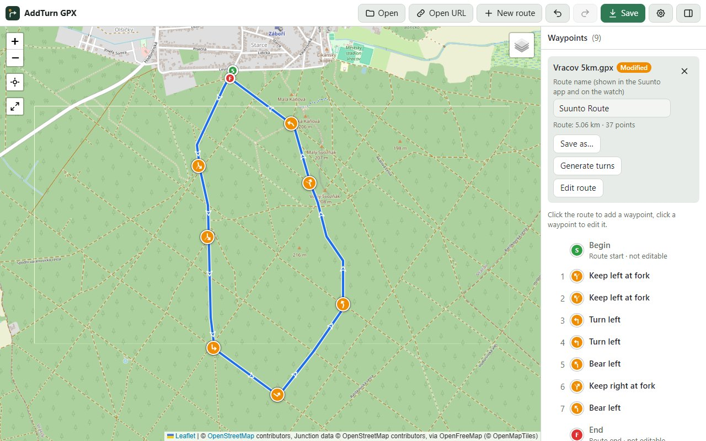
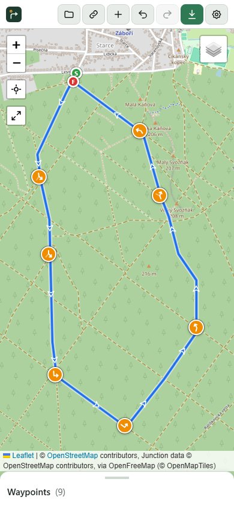
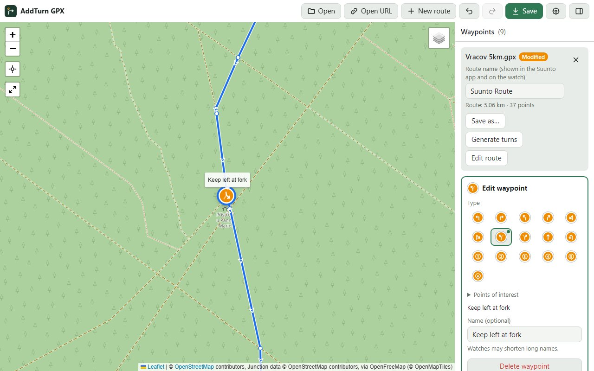
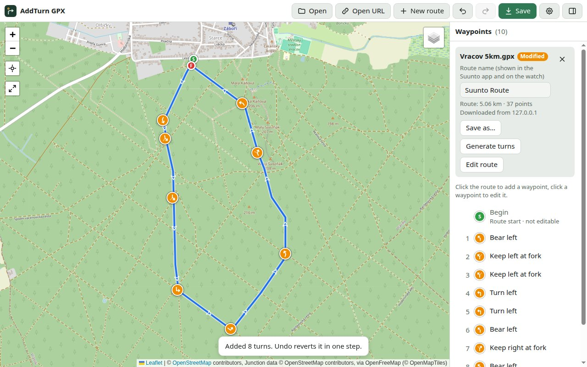
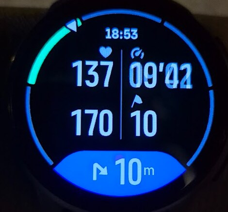

# AddTurn GPX

English version: [README.md](README.md)

**Varování!!!**

1. Testuji pouze na Suunto Race 2
2. Na firmware 2.56.28 se mi doposud nepodařilo najít postup, který spolehlivě vede k tomu, aby hodinky ukazovaly vzdálenost k další odbočce. V tomto firmware je více chyb a cesta k úspěchu spočívá v přesně daném postupu plánování trasy. V podstatě se mi podařilo jen jednou dosáhnout toho, že pole "Vzdálenost k dalšímu POI/Waypointu" ukazovala správně vzdálenost. Bohužel jsem si nepoznamenal nastavení a od té doby nejsem schopen tento pokus zopakovat. Vím pouze, že to jde, ale netuším, jak. Počet kombinací je velmi velký...

Aplikace: <https://dushino.github.io/addturngpx/>

AddTurn GPX přidává do tras GPX navigační pokyny pro **hodinky Suunto**. Běží celá v prohlížeči, bez serveru a bez registrace.

Hodinky Suunto při navigaci po trase ukazují pokyn (odboč vlevo, na rozcestí vpravo…) a vzdálenost k němu. Dělají to ale jen u waypointů, které splňují přísné podmínky. Většina souborů GPX, včetně souborů z jiných plánovačů, tak skončí úplně bez pokynů. V AddTurn GPX si trasu otevřeš, pokyny přidáš ručně nebo je necháš vygenerovat automaticky na skutečných křižovatkách a uložíš soubor, který aplikace Suunto správně načte. Soubor se vždy uloží ve formátu vycházejícím z toho, který používá aplikace Suunto při sdílení trasy.

## Doporučený postup (ověřeno na hodinkách)

**Aplikace Suunto → sdílený odkaz → AddTurn GPX → import do aplikace Suunto**

Tenhle postup je vyzkoušený na skutečných hodinkách: hodinky ukazovaly každý pokyn s jeho ikonou a vzdálenost k dalšímu. Drž se ho přesně. Trasy odjinud (třeba GPX export přímo ze Suunto Routeplanneru nebo z jiných plánovačů) se při otevření převedou do formátu aplikace Suunto. Tenhle převod ale zatím na hodinkách vyzkoušený není.

1. **Naplánuj trasu v aplikaci Suunto** (nebo ji naplánuj v Suunto Routeplanneru a ulož do svého účtu Suunto, aby se objevila v aplikaci).
2. **V aplikaci Suunto trasu nasdílej.** Dostaneš odkaz ve tvaru `https://api.sports-tracker.com/apiserver/v2/routes/export/…?brand=SUUNTOAPP&format=gpx-route`.
3. **V AddTurn GPX klikni na Open URL a odkaz vlož.** Aplikace stáhne trasu přesně tak, jak ji aplikace Suunto exportuje.
4. **Přidej pokyny:** v panelu klikni na **Generate turns**; odbočky se přidají hned (jedno Undo je vrátí). Nebo je přidej sám kliknutím na trasu.
5. **Klikni na Save.** Změní se jen waypointy, zbytek souboru zůstane přesně takový, jak ho aplikace Suunto vyexportovala.
6. **Uložený soubor naimportuj do aplikace Suunto** jako trasu a synchronizuj do hodinek.
7. **Zkontroluj [nastavení hodinek](#na-hodinkách)** a nenaviguj trasu pozpátku.

## Otevření trasy

- **Open URL**: vlož odkaz na soubor GPX. Trasa sdílená z aplikace Suunto dá odkaz ve tvaru `https://api.sports-tracker.com/apiserver/v2/routes/export/…?brand=SUUNTOAPP&format=gpx-route`, který aplikace umí stáhnout přímo. Fungují i odkazy na soubory na `github.com`. Jiné weby fungují jen tehdy, když dovolí ostatním webům své soubory stahovat. Pokud ne, aplikace to ohlásí a soubor si můžeš stáhnout v prohlížeči a otevřít přes **Open**.
- **Open**: vyber soubor `.gpx` v zařízení. Na počítači ho můžeš také přetáhnout do okna.
- **Sdílení na Androidu**: ve správci souborů vyber soubor `.gpx` a zvol *Sdílet* → *AddTurn GPX*. Je k tomu potřeba [nainstalovaná aplikace](#instalace-na-telefon-a-provoz-offline). V seznamu *Otevřít v aplikaci* ukazuje Android jen nativní aplikace, takže tam AddTurn GPX být nemůže. Sdílet jde vždy jen jeden soubor.
- **Otevřít v aplikaci na počítači**: pokud máš aplikaci nainstalovanou z Chrome nebo Edge, klikni na soubor `.gpx` pravým tlačítkem a zvol *Otevřít v programu* → *AddTurn GPX*. Prohlížeč se poprvé zeptá na povolení.
- **Odkaz, který rovnou otevře trasu**: k adrese aplikace přidej `?url=` a zakódovanou adresu souboru GPX, například `https://dushino.github.io/addturngpx/?url=https%3A%2F%2F…`.

Aplikace si pamatuje otevřený soubor i neuložené úpravy, takže zavřením záložky nebo obnovením stránky o práci nepřijdeš.

## Plánování nové trasy

**New route** naplánuje trasu na mapě: ty umístíš body a [GraphHopper](https://www.graphhopper.com) mezi nimi najde cestu po skutečných cestách. Nepotřebuješ to, když už trasu máš v aplikaci Suunto nebo v souboru GPX.

Hledání cesty potřebuje **tvůj vlastní bezplatný API klíč**. Získáš ho za pár minut:

1. Založ si bezplatný účet na [graphhopper.com](https://graphhopper.com/dashboard/signup).
2. V dashboardu otevři [API Keys](https://graphhopper.com/dashboard/api-keys) a zkopíruj klíč.
3. V AddTurn GPX klikni na **New route** a klíč vlož. Aplikace si ho zapamatuje v tomto prohlížeči. Změníš nebo smažeš ho v **Settings** (ozubené kolo v horní liště).

Pak naplánuj trasu:

- **Foot** nebo **Bike** nastaví profil. Platí pro další přidané body, takže jedna trasa může kombinovat obojí.
- **Přidání bodu**: klikni (nebo klepni) do mapy. První bod je start.
- **Úprava trasy na počítači**: bod posuneš tažením, smažeš kliknutím a tažením čáry přidáš bod mezi dva stávající.
- **Úprava trasy na telefonu nebo tabletu**: bod posuneš tažením prstem. Nebo na něj klepni a pak klepni do mapy, kam se má přesunout, případně na **Remove** v liště nahoře. Bod mezi dva stávající přidáš dlouhým stiskem čáry.
- **Back to start** přidá cestu zpět k prvnímu bodu, když chceš uzavřít okruh.
- **Undo** a **Redo** fungují pro všechny tyto úpravy. V panelu vidíš délku, stoupání a klesání. Rozpracovaná trasa přežije obnovení stránky.
- **Finish** vytvoří soubor GPX ve formátu aplikace Suunto a vrátí tě k běžným úpravám: přejmenuj trasu, přidej odbočky přes Generate turns a ulož. Zpět do plánování se potom už nedostaneš.

Dobré vědět:

- Bezplatný plán GraphHopperu je jen pro **nekomerční použití**, dává 500 kreditů denně a má limit za minutu. Přidání bodu stojí obvykle 1 kredit, posun nejvýš 2 a Undo nic. Když narazíš na minutový limit, aplikace počká a pokračuje sama.
- Soubor prochází stejným převodem jako soubory z jiných plánovačů, takže na hodinkách zatím není vyzkoušený (viz [Doporučený postup](#doporučený-postup-ověřeno-na-hodinkách)).

## Obrazovka

- **Mapa**: trasa se šipkami ve směru jízdy a waypointy. Tlačítka vlevo přibližují a oddalují, ukážou tvou polohu (ikona zmodrá, dalším klepnutím poloha zmizí) a **⤢ Fit route** ukáže celou trasu, i tu právě plánovanou. Tlačítkem vrstev vpravo přepínáš mezi **OpenStreetMap**, **OpenTopoMap** (turistická mapa s vrstevnicemi) a **Satellite (Esri)**.
- **Panel** (na počítači vpravo, na telefonu vysouvací panel dole): údaje o souboru, **název trasy**, který ukáže aplikace Suunto a hodinky (můžeš ho kdykoli upravit; Zpět funguje jako u ostatních úprav), a seznam waypointů v pořadí, v jakém na ně na trase narazíš.
- **Lišta**: Open, Open URL, New route, Undo, Redo, Save, Settings. Název (nebo ikona) aplikace vlevo otevře tuto stránku projektu na GitHubu.

Rozložení se přizpůsobí obrazovce (počítač, tablet, telefon) a ovládání se řídí světlým nebo tmavým režimem systému. Samotná mapa zůstává vždy světlá.

## Barvy a ikony

| Značka | Význam |
| --- | --- |
| Oranžové kolečko se šipkou | Pokyn k odbočení. Šipka je natočená podle směru příjezdu, takže „odboč vpravo“ ukazuje doprava tak, jak to uvidíš v terénu. |
| Oranžové kolečko s kroužkem a číslem | Kruhový objezd, číslo je výjezd |
| Modré kolečko se symbolem | Bod zájmu – voda a moře (voda, zdroj vody, řeka, jezero, vodopád, pláž…) |
| Zelené kolečko se symbolem | Bod zájmu – příroda, terén a zvěř (les, vrchol, jeskyně, houby, zvěř, místo k rybaření…) |
| Hnědé kolečko se symbolem | Bod zájmu – jídlo a nocleh (kavárna, restaurace, hotel, tábořiště, ohniště…) |
| Tyrkysové kolečko se symbolem | Bod zájmu – orientace a doprava (informace, vyhlídka, parkoviště, silnice, stezka, křižovatka, geocache) |
| Červené kolečko se symbolem | Bezpečnost: nebezpečí, lavina, nouze, občerstvovací stanice |
| Fialové kolečko se špendlíkem | Obecný waypoint (bez typu nebo s typem, který hodinky neznají) |
| Zelené **S** / červené **F** | Začátek a konec trasy (*Begin* a *End* ze Suunto). Zobrazují se, ale needitují. |
| Šedá s červeným čárkovaným okrajem | **Waypoint neleží na bodu trasy, a Suunto ho proto ignoruje.** Seznam ukáže vzdálenost k nejbližšímu bodu trasy a editor nabídne tlačítko *Snap to nearest route point*. |
| Modrý obrys, mírně zvětšený | Vybraný waypoint (ponechá si barvu svého typu) |

Všech 78 typů waypointů, které Suunto zná, má vlastní ikonu. V editoru jsou body zájmu seřazené do stejných skupin. Další upozornění v seznamu:

- **Neznámý typ**: Suunto waypoint ukáže jako obecný *Waypoint*.
- **Více tras v jednom souboru**: Suunto každou naimportuje jako samostatnou trasu.

## Úpravy trasy

**Edit route** v panelu (vedle *Generate turns*) umožní změnit čáru každé otevřené trasy, i té naplánované v aplikaci po *Finish*:

- **Počítač**: bod trasy posuneš tažením, smažeš kliknutím, tažením čáry vložíš nový bod.
- **Telefon nebo tablet**: bod trasy táhni prstem, nebo na něj klepni a pak klepni do mapy, kam se má přesunout. **Remove** v liště nahoře vybraný bod smaže. Dlouhým stiskem čáry vložíš bod na čáru; zůstane vybraný, takže ho klepnutím do mapy hned přesuneš.
- **Follow roads** (výchozí zapnuto) najde cestu po silnicích a cestách přes GraphHopper s tvým API klíčem (viz [Plánování nové trasy](#plánování-nové-trasy)) a profilem **Foot** / **Bike**. Posun, vložení nebo smazání bodu přeplánuje trasu od předchozího po následující waypoint (odbočka, bod zájmu, Begin, End), nejdál 500 m na každou stranu; zbytek trasy zůstane, jak je. Každá změna stojí zhruba 1 kredit. Odbočky na upravovaném bodu zmizí, body zájmu na něm se přichytí na nejbližší bod nové trasy (do 50 m, jinak zmizí). Aplikace řekne, co se stalo.
- S vypnutým **Follow roads** vede mezi body rovná čára (hodí se pro cestu, která v OpenStreetMap není). Waypointy na posunutém bodu se posunou s ním (Suunto je potřebuje na bodu trasy) a se smazaným bodem zmizí. Posunutý bod si ponechá výšku.
- Begin a End zůstanou na prvním a posledním bodu.
- Odbočky jinde se neaktualizují. Po úpravách stiskni znovu **Generate turns**.
- **Done** (nebo Esc) úpravy ukončí. Každá změna je jeden krok Undo.

## Úpravy waypointů

- **Přidání**: klikni (nebo klepni) na čáru trasy tam, kde ještě žádný waypoint není. Nový waypoint se přichytí k nejbližšímu bodu trasy a otevře se jeho editor.
  - Když v místě kliknutí žádný bod trasy není (dlouhý rovný úsek), aplikace vloží nový bod trasy přesně na čáru. Tvar trasy se nezmění.
  - Typ se navrhne podle úhlu trasy v daném místě. Když je vybraný waypoint s typem bodu zájmu (třeba *Water point*), nový dostane stejný typ, takže jich rychle přidáš víc.
  - S myší kurzor ukazuje, co kliknutí udělá: **kříž** nad trasou (přidá waypoint), **ukazováček** u waypointu (vybere ho) a otevřená ruka jinde (tažením posuneš mapu).
- **Úprava**: klikni na waypoint na mapě (nebo těsně vedle něj) či v seznamu a otevře se editor. Kliknutím do prázdného místa mapy nebo klávesou Esc editor zavřeš.
  - **Type (typ)**: nahoře pokyny k odbočení a kruhové objezdy, pod *Points of interest* body zájmu. Zelená tečka označuje typ navržený podle úhlu trasy.
  - **Name (název)** je nepovinný. Hodinky mohou dlouhé názvy zkrátit. Každá nová odbočka dostane jako název text pokynu, například *Bear right*, ať ji přidáš ručně, nebo generátorem. Při změně typu se tento text změní s ním. Název, který napíšeš sám, zůstane.
  - **◀ Previous point / Next point ▶** posunou waypoint po trase.
  - **Delete waypoint** smaže waypoint, s potvrzením.
- **Tažení**: značku můžeš na počítači přetáhnout myší. Po puštění se přichytí na trasu.
- **Undo / Redo**: každou úpravu jde vrátit, i automatické generování jedním krokem.
- **Modified** u názvu souboru znamená, že změny ještě nejsou uložené do souboru. Aplikace se zeptá, než soubor zavřeš nebo otevřeš jiný.

## Automatické pokyny

Tlačítko **Generate turns** v panelu s údaji o souboru rovnou přidá do trasy pokyny k odbočení. Během načítání dat o cestách je na tlačítku *Generating…* a pod ním průběh; výsledek oznámí krátká hláška a jedno **Undo** vše vrátí:

- Stáhne z **OpenStreetMap** síť silnic a cest v okolí trasy a pokyny dává **jen na křižovatky**. Zatáčka bez křižovatky pokyn nedostane. Výjimkou je **otočka**: kde se trasa vrací po stejné cestě (třeba na konci krátké odbočky slepou cestou nebo na obratu trasy tam a zpět), přidá *U-turn*, i uprostřed cesty. Krátká odbočka tohoto druhu často vznikne bodem plánovače položeným kousek za křižovatku – pokud jsi tam a zpět jet nechtěl, oprav trasu.
- Síť cest čte z **vektorových mapových dlaždic** OpenStreetMap kolem trasy: nejdřív z [OpenFreeMap](https://openfreemap.org), a když není dostupné, z [vektorových dlaždic OpenStreetMap](https://vector.openstreetmap.org). Teprve když selžou oba zdroje, zeptá se datového serveru [Overpass API](https://overpass-api.de). Použitý zdroj je uvedený v řádku atribuce mapy.
- Na křižovatce, kde trasa změní směr aspoň o *minimální úhel*, přidá odbočku (mírně, vlevo/vpravo, ostře, otočit se). Pozná i **rozcestí**, kde se cesta dělí do dvou podobných směrů, a přidá *Keep left / right at fork*, i když trasa jede skoro rovně (jen tam, kde trasa jede po jedné z obou větví). To je přesně případ, kdy hodinky obvykle žádný pokyn nedají.
- Pokaždé **nahradí** waypointy odboček a rozcestí (vlevo/vpravo, mírně, ostře, otočit se, rozcestí), i ty přidané ručně, a vypočítá je znovu. Kruhové objezdy, „rovně“, body zájmu a začátek/konec zůstávají vždy. Odbočky, které vyjdou stejně, se za změnu nepočítají, takže opakované generování bez změny oznámí, že odbočky jsou aktuální.
- **Minimum angle** (minimální úhel, výchozí 20°) a **Minimum spacing** (minimální rozestup, výchozí 15 m) jde změnit v **Settings** (ozubené kolo v horní liště). Rozestup zabrání tomu, aby vznikly waypointy pár centimetrů od sebe.
- **Turns in advance** (předstih, výchozí 0 m, nejvýš 100 m), také v **Settings**: každá vygenerovaná odbočka se umístí o tolik metrů před křižovatku na nový bod trasy, takže ji hodinky ohlásí dřív. Tvar trasy se nezmění. Předstih se zkrátí tak, aby odbočka nikdy neležela před předchozí křižovatkou (nebo waypointem) – jinak by se dalo odbočit o křižovatku dřív. Na trase tam a zpět pak odbočka tam a odbočka zpět na stejné křižovatce dostanou různé body. Po změně hodnoty stiskni znovu **Generate turns**.
- Kruhové objezdy a „rovně“ z tvaru sítě poznat nejde, ty případně přidej ručně.
- Generování napoprvé potřebuje internet. Načtení mapových dlaždic obvykle trvá sekundu nebo dvě. Když některý zdroj selže, aplikace automaticky zkusí další a ukazuje průběh; server Overpass bývá často vytížený, takže dostane až 3 pokusy. Když selže všechno, hláška řekne proč; stiskni **Generate turns** později znovu.
- Stažená data o cestách kolem trasy si aplikace **uloží v prohlížeči na 30 dní**, takže další generování (i po znovuotevření aplikace nebo přidání waypointů) server nepotřebuje. **Clear road data** v **Settings** je smaže, takže je další generování stáhne znovu – třeba když se mapa změnila. Nová verze aplikace uložená data o cestách smaže, takže je další generování stáhne znovu. Otevřená a plánovaná trasa i nastavení zůstanou.

## Uložení

- **Save** (Ctrl+S):
  - V Chrome a Edge na počítači přepíše otevřený soubor.
  - U trasy otevřené z URL se zeptá, kam uložit.
  - V ostatních prohlížečích a na telefonu se soubor stáhne.
- **Save as…** (Ctrl+Shift+S) se vždy zeptá na nový soubor.
- Když vzniká nový soubor (Save as… nebo stažení), jeho název se navrhne podle názvu trasy, například *Ranní okruh.gpx*.
- **Na telefonu**: Soubor ulož a pak ho otevři ze *Stažených* v aplikaci Suunto.

**Soubory se ukládají ve formátu vycházejícím z aplikace Suunto.** Má strukturu trasy sdílené z aplikace Suunto, navíc konce řádků pro lepší čitelnost a jako autora (`creator`) `AddTurn gpx 1.0`.

- **Soubor uložený v AddTurn GPX zůstane přesně takový, jaký byl.** Aplikace mění jen waypointy (a body trasy, které přidáš). Všechno ostatní zůstane bajt po bajtu stejné.
- **Každý jiný soubor se při otevření převede**, třeba trasa sdílená z aplikace Suunto, GPX export ze Suunto Routeplanneru nebo jiného plánovače, nebo track. Aplikace na převod upozorní a označí soubor jako *Modified*. Výsledek si ulož. Převedený soubor obsahuje:
  - jednu trasu (`<rte>`) se všemi body původních tras a tracků, každý s polohou a výškou;
  - waypointy v pořadí trasy od *Begin* po *End*, každý s výškou, názvem, popisem a typem. *Begin* a *End* se doplní, když je soubor nemá, stejně jako to dělá aplikace Suunto. Body trasy, které měly název nebo typ, se stanou samostatnými waypointy;
  - název trasy v metadatech.

  Všechno ostatní se vynechá: komentáře, rozšíření (včetně dat Suunto Routeplanneru, jako je `suunto-rp:waypointIndices`) a další údaje bodů.
- Nové waypointy dostanou výšku svého bodu trasy, stejně jako waypointy v souboru z aplikace Suunto.
- Soubor v jiném kódování než UTF-8 (například `windows-1250`) se načte správně a uloží jako UTF-8.

## Jak Suunto čte waypointy

Podle [specifikace tras Suunto](https://apizone.suunto.com/route-description) se waypoint naimportuje, jen když:

- je to `<wpt>` se **stejnými souřadnicemi jako některý bod trasy** (`rtept`/`trkpt`), nebo
- je to bod trasy, který má `name` nebo `type`.

První podmínka je nejčastější důvod, proč waypointy z ostatních souborů GPX při importu zmizí. AddTurn GPX waypointy vždy umisťuje na body trasy, souřadnice kopíruje přesně a upozorní na každý waypoint, který na bodu trasy neleží. Waypoint bez názvu dá pokyn bez jména. Waypoint bez typu se stane obecným *Waypoint*. Ověřeno v praxi na hodinkách: trasu navigovaly a ukazovaly vzdálenost k dalšímu pokynu.

## Na hodinkách

Při navigaci po trase hodinky hlásí pokyny ze souboru:

- **Modré pole dole**: blíží se waypoint. Ukazuje jeho ikonu (tady ostré odbočení vpravo) a vzdálenost k němu (10 m).
- **Pravé spodní pole**: zbývající vzdálenost k dalšímu waypointu.
- Ostatní pole (tep, tempo…) závisí na tom, jak máš nastavený displej hodinek.

**Nastavení hodinek:** v hodinkách **vypni** navigaci po trase, ale **zapni** upozornění na body zájmu (POI). Jinak se pokyny ze souboru nehlásí.

> **⚠ Nenaviguj trasu pozpátku.** Pokyny platí pro směr, ve kterém byla trasa naplánovaná. Když v hodinkách zvolíš průchod trasou v opačném směru, šipky ukazují špatně: z „odboč vpravo“ se při příjezdu z druhé strany stane odbočka vlevo. Chceš-li trasu jet obráceně, naplánuj ji nejdřív v tomto směru a pokyny přidej do ní.

## Instalace na telefon a provoz offline

Aplikaci jde nainstalovat jako běžnou aplikaci s vlastní ikonou a pak funguje i bez internetu. Mapové podklady a automatické generování internet potřebují dál.

Aplikace se vždy spustí hned z kopie uložené v zařízení, i při slabém signálu nebo bez něj. Nové verze se stahují na pozadí; když je nová verze připravená, objeví se lišta *New version available* – klepnutím na **Reload** se přepneš na novou verzi (otevřená trasa i úpravy zůstanou), ✕ ji odloží na příští spuštění.

- **Android (Chrome)**: otevři aplikaci a v menu ⋮ zvol instalaci aplikace (případně přidání na plochu).
- **iPhone / iPad (Safari)**: tlačítko Sdílet → přidat na plochu.

Pokud se *AddTurn GPX* po aktualizaci neobjeví v nabídce *Sdílet*, ulož si práci, aplikaci odeber a nainstaluj ji znovu.

Pokud Chrome na Androidu hlásí *„This app is already installed“*, i když nainstalovaná není, nebo *„Could not open app“*, máš z `dushino.github.io` nainstalovanou jinou aplikaci (třeba OK Trainer). Je to chyba Chrome 154–156, opravená v Chrome 157: aktualizuj Chrome a nainstaluj aplikaci znovu. Údaje o prohlížení kvůli tomu nemaž: smažeš si tím i nastavení a API klíč.

## Data a soukromí

Aplikace nemá server ani uživatelské účty a nic nesleduje. Otevřená trasa, neuložené úpravy, nastavení a stažená data o cestách se ukládají jen v tvém prohlížeči, v tvém zařízení.

S jinými službami aplikace komunikuje jen kvůli těmto úkolům:

- **Mapové podklady**: OpenStreetMap, OpenTopoMap nebo Esri, podle zvolené mapy.
- **Open URL**: stáhne soubor z adresy, kterou zadáš.
- **New route**: pošle souřadnice bodů trasy a tvůj API klíč do [GraphHopperu](https://www.graphhopper.com). Klíč je uložený jen v tvém prohlížeči.
- **Generate turns**: stáhne mapové dlaždice kolem trasy z [OpenFreeMap](https://openfreemap.org) nebo z [vektorových dlaždic OpenStreetMap](https://vector.openstreetmap.org), takže tyto služby uvidí oblast trasy. Teprve když selžou oba zdroje, pošle souřadnice trasy na [Overpass API](https://overpass-api.de).

## Klávesové zkratky

| Zkratka | Akce |
| --- | --- |
| Ctrl+Z | Zpět (Undo) |
| Ctrl+Y / Ctrl+Shift+Z | Znovu (Redo) |
| Ctrl+S | Uložit |
| Ctrl+Shift+S | Uložit jako… |
| Esc | Zavřít editor nebo Edit route |

Na Macu místo Ctrl použij Cmd.

## Licence a poděkování

- AddTurn GPX je pod licencí [GNU GPL v3](LICENSE).
- Mapová knihovna: [Leaflet](https://leafletjs.com) (BSD 2-Clause, `vendor/leaflet/LICENSE`).
- Ikony bodů zájmu: [Tabler Icons](https://tabler.io/icons) (MIT, `vendor/tabler-icons/LICENSE`).
- Mapová data a mapy:
  - © přispěvatelé [OpenStreetMap](https://www.openstreetmap.org/copyright) (ODbL)
  - [OpenTopoMap](https://opentopomap.org) (CC-BY-SA)
  - satelitní snímky © Esri (Source: Esri, Vantor, Earthstar Geographics, and the GIS User Community)
- Hledání cesty: [GraphHopper API](https://www.graphhopper.com), mapová data © přispěvatelé OpenStreetMap.
- Data o křižovatkách: © přispěvatelé OpenStreetMap, přes [OpenFreeMap](https://openfreemap.org) (© [OpenMapTiles](https://openmaptiles.org)), [vektorové dlaždice OpenStreetMap](https://vector.openstreetmap.org) nebo [Overpass API](https://overpass-api.de).

## Pro vývojáře

- Celá aplikace je jeden soubor `index.html` (HTML, CSS a JavaScript) bez build kroku a bez závislostí kromě přiloženého Leafletu. `sw.js` je service worker pro provoz offline. Při každé změně souborů aplikace zvyš `CACHE_NAME`.
- Spouštěj ji přes HTTP, například `python3 -m http.server` ve složce projektu, a otevři `http://localhost:8000`. Při otevření přímo ze souboru (`file://`) OpenStreetMap mapové dlaždice blokuje.
- `samples/` obsahuje testovací soubory GPX: exporty ze Suunto, všechny typy odboček, kruhové objezdy a body zájmu, waypointy v bodech trasy, soubor ve `windows-1250` a vadné soubory.
- `tests/` obsahuje automatické testy. Spouštějí se příkazem `node tests/run.mjs tests/tiles.json tests/generator.json tests/editing.json tests/clicks.json tests/categories.json tests/offline.json`, viz [tests/README.md](tests/README.md).
- `docs/dev/` obsahuje vývojové poznámky: rozhodnutí o návrhu, postup a seznam úkolů.
