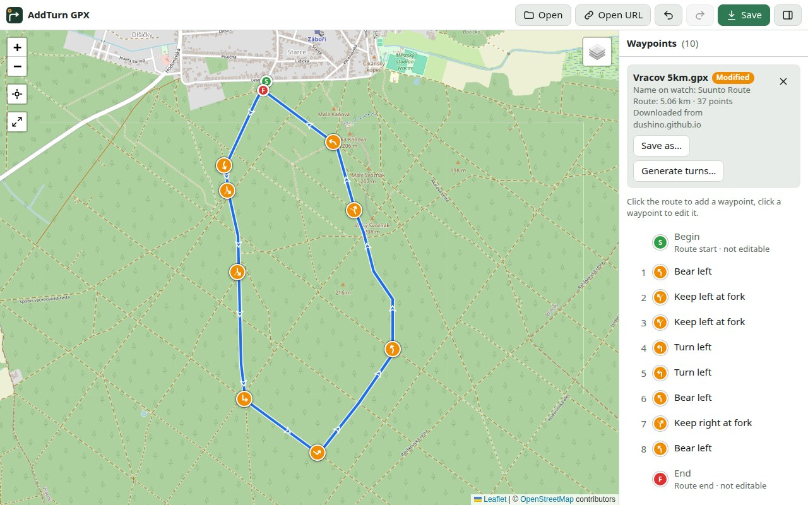
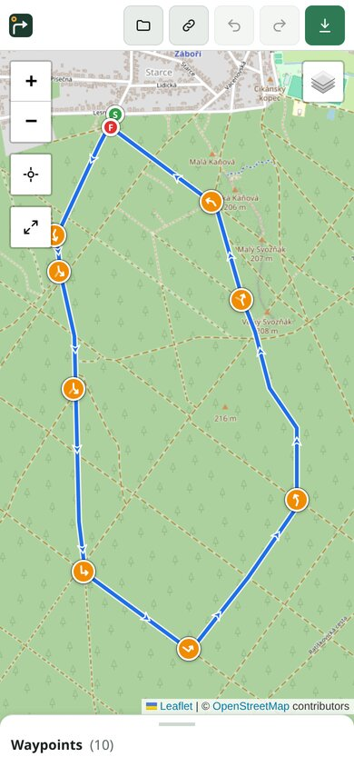
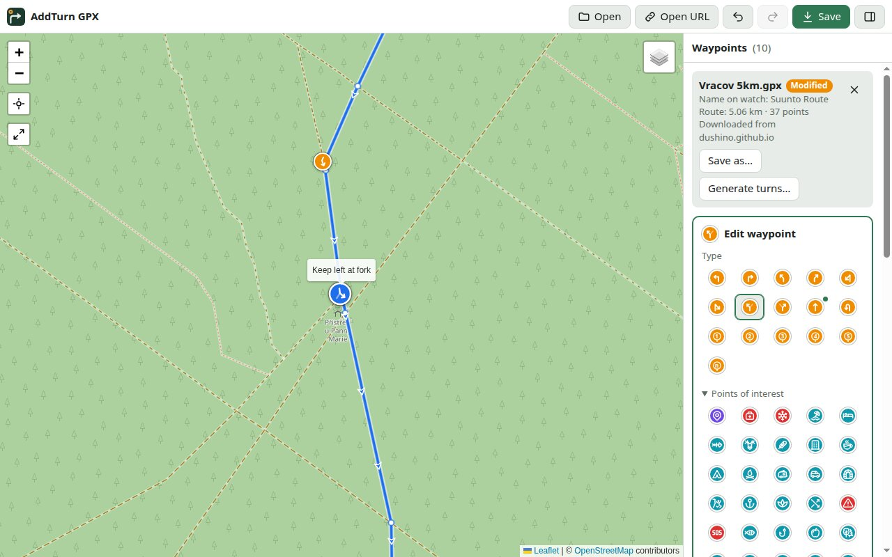
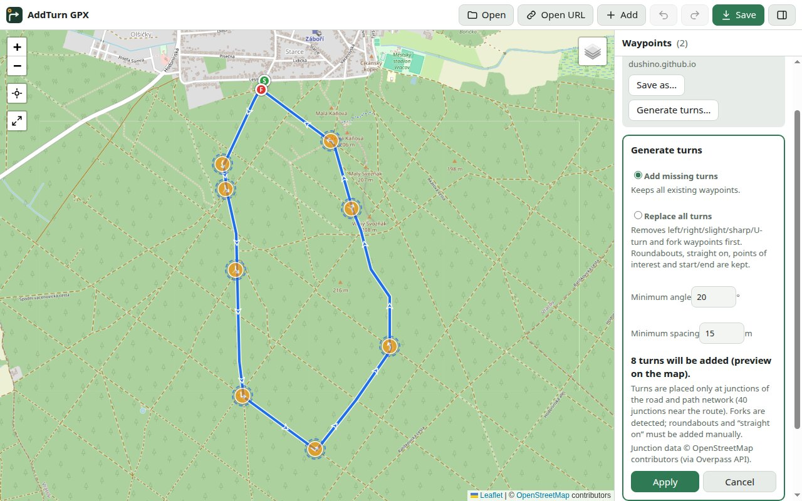
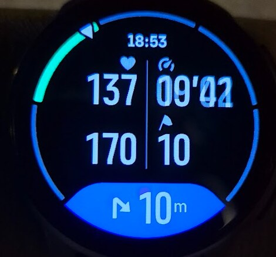

# AddTurn GPX

Česká verze je zde: [README-CZ.md](README-CZ.md)

**Warning!!!**

1. I test only on a Suunto Race 2.
2. On firmware 2.56.28 I haven't yet found a procedure that reliably makes the watch show the distance to the next turn. This firmware has several bugs, and getting it to work depends on following an exact route-planning procedure. I have managed only once to get the "Distance to next POI/waypoint" field to show the correct distance. Unfortunately, I didn't write down the settings, and since then I haven't been able to repeat it. All I know is that it can work, but I don't know how. The number of possible combinations is very large...

Application: <https://dushino.github.io/addturngpx/>

AddTurn GPX adds turn-by-turn navigation instructions to GPX routes for **Suunto watches**. It runs entirely in your browser, with no server and no account. Only the optional route planner needs a free GraphHopper account.

Suunto watches show an instruction (turn left, keep right at a fork, …) and the distance to it while you navigate a route. They only do that for waypoints that meet strict conditions, though, and most GPX files, including many made in other planners, end up with no instructions at all. AddTurn GPX lets you open a route, add the instructions by hand or generate them automatically at real junctions, and save a file that the Suunto app imports correctly. The file is always saved in the same format the Suunto app uses when you share a route, because that is the format confirmed to work on the watch.

## Recommended workflow (tested on a watch)

**Suunto app → shared link → AddTurn GPX → import into the Suunto app**

This is the path that has been tested on a real watch: the watch showed each instruction with its icon and the distance to the next one. Follow it exactly. Routes from other places (for example a GPX export straight from Suunto Routeplanner, or other planners) are converted to the Suunto app format when you open them, but this conversion hasn't been tested on a watch yet.

1. **Plan the route in the Suunto app** (or plan it in Suunto Routeplanner and save it to your Suunto account, so it appears in the app).
2. **Share the route in the Suunto app.** You get a link like `https://api.sports-tracker.com/apiserver/v2/routes/export/…?brand=SUUNTOAPP&format=gpx-route`.
3. **In AddTurn GPX, click Open URL and paste the link.** The app downloads the route exactly as the Suunto app exports it.
4. **Add the instructions:** click **Turns generator** in the panel, then **Generate turns**, check the preview on the map and click **Apply**. Or add them yourself by clicking the route.
5. **Click Save.** Only the waypoints change; the rest of the file stays exactly as the Suunto app exported it.
6. **Import the saved file into the Suunto app** as a route and sync it to your watch.
7. **Check the [watch settings](#on-the-watch)** and don't navigate the route in reverse.

## Opening a route

- **Open URL**: paste a link to a GPX file. A route shared from the Suunto app gives a link like `https://api.sports-tracker.com/apiserver/v2/routes/export/…?brand=SUUNTOAPP&format=gpx-route`, and the app can download it directly. Links to files on `github.com` work too. Other websites work only if they allow other sites to download their files. If they don't, the app says so, and you can download the file in your browser and use **Open** instead.
- **Open**: choose a `.gpx` file on your device. On a computer you can also drag the file into the window.
- **Link that opens a route directly**: add `?url=` and the encoded address of the GPX file to the app address, for example `https://dushino.github.io/addturngpx/?url=https%3A%2F%2F…`.

The app remembers the open file and your unsaved changes, so closing the tab or reloading the page doesn't lose your work.

## Planning a new route

**New route** plans a route on the map: you place the points and [GraphHopper](https://www.graphhopper.com) finds the way along real paths between them. You don't need this if you already have a route in the Suunto app or in a GPX file.

The route search needs **your own free API key**, which takes a few minutes to get:

1. Create a free account at [graphhopper.com](https://graphhopper.com/dashboard/signup).
2. Open [API Keys](https://graphhopper.com/dashboard/api-keys) in the dashboard and copy your key.
3. Click **New route** in AddTurn GPX and paste the key. The app remembers it in this browser. To change or remove it, use the **API key** button in the panel.

Then plan the route:

- **Foot** or **Bike** sets the profile. It applies to the next points you add, so one route can combine both.
- **Add a point**: click (or tap) the map. The first point is the start.
- **Change the route on a computer**: drag a point to move it, click it to remove it, or drag the line to add a point in between.
- **Change the route on a phone or tablet**: tap a point, then tap the map where it should go, or tap **Remove** in the bar at the top. To add a point in between, press and hold the line.
- **Back to start** adds the way back to the first point, to close a loop.
- **Undo** and **Redo** work for all of this. Distance, ascent and descent are shown in the panel. A route in progress survives reloading the page.
- **Finish** creates the GPX file in the Suunto app format and returns you to normal editing: rename the route, add turns with the Turns generator, and save. You can't go back to planning after that.

Good to know:

- GraphHopper's free plan is for **non-commercial use**, gives 500 credits a day and has a limit per minute. Adding a point usually costs 1 credit, moving one up to 2, and Undo costs nothing. If you hit the per-minute limit, the app waits and continues by itself.
- The file goes through the same conversion as files from other planners, so this hasn't been tested on a watch yet (see [Recommended workflow](#recommended-workflow-tested-on-a-watch)).

## The screen

- **Map**: the route with arrows showing the direction of travel, plus the waypoints. The buttons on the left zoom in and out, show your location, and **⤢ Fit route** shows the whole route. The layers button on the right switches between **OpenStreetMap**, **OpenTopoMap** (topographic map with contour lines) and **Satellite (Esri)**.
- **Panel** (on the right on a computer, a pull-up sheet at the bottom on a phone): file details, the **route name** that the Suunto app and the watch will show (you can edit it at any time; Undo works as for other changes), and the list of waypoints in the order you'll reach them on the route.
- **Toolbar**: Open, Open URL, New route, Undo, Redo, Save. The app name (or icon) on the left opens this project page on GitHub.

The layout adapts to the screen (computer, tablet, phone), and the controls follow your system's light or dark mode. The map itself always stays light.

## Colours and icons

| Marker | Meaning |
| --- | --- |
| Orange circle with an arrow | Turn instruction. The arrow is rotated to match the direction you arrive from, so "turn right" points right as you'll see it on the ground. |
| Orange circle with a ring and number | Roundabout, the number is the exit |
| Blue circle with a symbol | Point of interest – water & sea (water, water point, river, lake, waterfall, beach, …) |
| Green circle with a symbol | Point of interest – nature, terrain & wildlife (forest, peak, cave, mushrooms, game, fishing spot, …) |
| Brown circle with a symbol | Point of interest – food & lodging (café, restaurant, hotel, camp, campfire, …) |
| Turquoise circle with a symbol | Point of interest – orientation & transport (info, sight, parking, road, trail, crossroads, geocache) |
| Red circle with a symbol | Safety: danger, avalanche, emergency, aid station |
| Purple circle with a pin | Plain waypoint (no type, or a type the watch doesn't know) |
| Green **S** / red **F** | Start and finish of the route (Suunto's *Begin* and *End*). Shown but not editable. |
| Grey with a dashed red outline | **The waypoint is not on a route point, so Suunto will ignore it.** The list shows the distance to the nearest route point, and the editor has a *Snap to nearest route point* button. |
| Blue ring, slightly larger | The selected waypoint (it keeps the colour of its type) |

All 78 waypoint types that Suunto supports have their own icon. In the editor, points of interest are listed under the same groups. Other warnings in the list:

- **Unknown type**: Suunto shows the waypoint as a plain *Waypoint*.
- **Several tracks or routes in one file**: Suunto imports each one as a separate route.

## Editing waypoints

- **Add**: click (or tap) the route line where there is no waypoint yet. The new waypoint snaps to the nearest route point and its editor opens.
  - If there is no route point near the place you clicked (a long straight section), the app adds a new route point exactly on the line. The shape of the route doesn't change.
  - The type is suggested from the angle of the route at that point. If a waypoint with a point-of-interest type is selected (for example *Water point*), the new one gets the same type, which makes adding several of them quick.
  - With a mouse, the cursor shows what a click will do: a **crosshair** over the route (adds a waypoint), a **pointing hand** at a waypoint (selects it), and an open hand elsewhere (drag to move the map).
- **Edit**: click a waypoint on the map (or close to it) or in the list to open the editor. Click an empty place of the map, or press Esc, to close the editor.
  - **Type**: turn instructions and roundabouts at the top, points of interest under *Points of interest*. A green dot marks the type suggested by the route angle.
  - **Name** (optional). Watches may shorten long names.
  - **◀ Previous point / Next point ▶** move the waypoint along the route.
  - **Delete waypoint**, with a confirmation.
- **Drag** a marker with the mouse (on a computer). It snaps to the route when you drop it.
- **Undo / Redo**: every change can be undone, including automatic generation as a single step.
- **Modified** next to the file name means the changes haven't been saved to a file yet. The app asks before you close the file or open another one.

## Automatic turn instructions

**Turns generator** in the file details panel opens the generator card. Set the options and press **Generate turns** to get a proposal:

- It downloads the road and path network around the route from **OpenStreetMap** and places instructions **only at junctions**. A bend in the road without a junction gets no instruction.
- The network is read from OpenStreetMap **vector map tiles** around the route: first from [OpenFreeMap](https://openfreemap.org), and if that isn't available, from the [OpenStreetMap vector tiles](https://vector.openstreetmap.org). Only if both fail does the app ask the [Overpass API](https://overpass-api.de) data server. The card shows which source was used.
- At a junction where the route changes direction by at least the *minimum angle*, it adds a turn (bear, turn, sharp, U-turn). It also recognises **forks**, where the way splits into two similar directions, and adds *Keep left / right at fork* even when the route goes almost straight. This is the case where watches typically give no instruction at all.
- **Add missing turns** keeps all existing waypoints and adds only new ones. **Replace all turns** first removes existing turn and fork waypoints and calculates them again. Roundabouts, "straight on", points of interest and start/finish are always kept.
- **Minimum angle** (default 20°) and **minimum spacing** (default 15 m) can be changed. Spacing prevents waypoints from ending up a few centimetres apart.
- The proposal appears on the map as a preview first and is written only after **Apply**. One **Undo** removes it all.
- Changing an option removes the preview and locks **Apply**. Press **Generate turns** again to get a new proposal; the road data are already loaded, so this is instant.
- Roundabouts and "straight on" can't be detected from the network shape, so add them by hand if you need them.
- Generating needs an internet connection the first time. Loading the map tiles usually takes a second or two. If a source fails, the app tries the next one automatically and shows its progress; the Overpass server is often busy, so it gets up to 3 attempts. If everything fails, use **Try again** later.
- Once downloaded, the road data for a route are **stored in your browser for 30 days**, so generating again (also after reopening the app or adding waypoints) doesn't need the server. **Refresh road data** downloads them again, for example when the map has changed.

## Saving

- **Save** (Ctrl+S):
  - In Chrome and Edge on a computer, Save overwrites the file you opened.
  - For a route opened from a URL, it asks where to save.
  - In other browsers and on phones, the file is downloaded.
- **Save as…** (Ctrl+Shift+S) always asks for a new file.
- When a new file is created (Save as…, or a download), its name is suggested from the route name, for example *Morning loop.gpx*.
- **On a phone**: Chrome on Android can't share GPX files to other apps. Save the file, then open it from *Downloads* in the Suunto app. Where the browser supports sharing GPX files, a **Share…** button appears.

**Files are saved in the Suunto app format.** This is the format of a route shared from the Suunto app, and it is the one confirmed to work on the watch.

- **A file shared from the Suunto app stays exactly as it was.** The app changes only the waypoints (and route points you added). Everything else is kept byte for byte.
- **Any other file is converted when you open it**, for example a GPX export from Suunto Routeplanner or another planner, or a track. The app tells you about the conversion and marks the file as *Modified*. Save it to keep the result. The converted file contains:
  - one route (`<rte>`) with all the points of the original routes and tracks, each with its position and elevation;
  - waypoints in route order, from *Begin* to *End*, each with its elevation, name, description and type. *Begin* and *End* are added if the file has none, like the Suunto app does. Route points that carried a name or type become separate waypoints;
  - the route name in the metadata.

  Everything else is left out: comments, extensions (including Suunto Routeplanner data such as `suunto-rp:waypointIndices`), and other details of points.
- New waypoints get the elevation of their route point, like waypoints in a file from the Suunto app.
- A file in an encoding other than UTF-8 (for example `windows-1250`) is read correctly and saved as UTF-8.

## How Suunto reads waypoints

According to [Suunto's route specification](https://apizone.suunto.com/route-description), a waypoint is imported only if:

- it is a `<wpt>` with **exactly the same coordinates as one of the route points** (`rtept`/`trkpt`), or
- it is a route point that has a `name` or `type`.

The first condition is the most common reason why waypoints from other GPX files disappear on import. AddTurn GPX always places waypoints on route points, copying the coordinates exactly, and warns you about any waypoint that isn't on one. A waypoint with no name gets an unnamed instruction. A waypoint with no type becomes a plain *Waypoint*. This was confirmed on real watches: they navigated the route and showed the distance to the next instruction.

## On the watch

While you navigate the route, the watch announces the instructions from the file:

- **Blue bar at the bottom**: a waypoint is coming up. It shows the waypoint's icon (here a sharp right turn) and the distance to it (10 m).
- **Bottom right field**: the remaining distance to the next waypoint.
- The other fields (heart rate, pace, …) depend on how you set up the watch display.

**Watch settings:** turn **off** route navigation on the watch, but turn **on** notifications for points of interest (POIs). Otherwise the instructions from the file are not announced.

> **⚠ Don't navigate the route in reverse.** The instructions are written for the direction in which the route was planned. If you choose on the watch to follow the route backwards, the arrows point the wrong way: a "turn right" becomes a left turn when you come from the other side. To ride the route in the opposite direction, plan the route in that direction first and add the instructions to it.

## Installing on your phone and offline use

The app can be installed like a regular app, with its own icon, and it then works without an internet connection. Map tiles and automatic generation still need a connection.

The app always starts straight away from the copy stored on your device, even with a weak or no signal. New versions are downloaded in the background; when one is ready, the bar *New version available* appears – tap **Reload** to switch to it (your open route and changes are kept), or ✕ to keep working and get it next time.

- **Android (Chrome)**: open the app, then use the ⋮ menu → *Install app* (or *Add to Home screen*).
- **iPhone / iPad (Safari)**: Share → *Add to Home Screen*.

If Chrome on Android says *"This app is already installed"* although it isn't, or *"Could not open app"*, clear Chrome's browsing data (Settings → Privacy and security → *Delete browsing data*) and install again.

## Data and privacy

The app has no server and no user accounts, and it doesn't track you. Your open route, unsaved changes, settings and downloaded road data are stored only in your browser, on your device.

The app talks to other services only for these tasks:

- **Map tiles**: OpenStreetMap, OpenTopoMap or Esri, depending on the selected map.
- **Open URL**: downloads the file from the address you enter.
- **New route**: sends the coordinates of your route points and your API key to [GraphHopper](https://www.graphhopper.com). The key is stored only in your browser.
- **Turns generator**: downloads the map tiles around the route from [OpenFreeMap](https://openfreemap.org) or the [OpenStreetMap vector tiles](https://vector.openstreetmap.org), which reveals the area of the route to these services. Only if both fail are the coordinates of the route sent to the [Overpass API](https://overpass-api.de).

## Keyboard shortcuts

| Shortcut | Action |
| --- | --- |
| Ctrl+Z | Undo |
| Ctrl+Y / Ctrl+Shift+Z | Redo |
| Ctrl+S | Save |
| Ctrl+Shift+S | Save as… |
| Esc | Close the editor or the Turns generator card |

On a Mac, use Cmd instead of Ctrl.

## Licence and credits

- AddTurn GPX is licensed under the [GNU GPL v3](LICENSE).
- Map library: [Leaflet](https://leafletjs.com) (BSD 2-Clause, `vendor/leaflet/LICENSE`).
- Icons for points of interest: [Tabler Icons](https://tabler.io/icons) (MIT, `vendor/tabler-icons/LICENSE`).
- Map data and maps:
  - © [OpenStreetMap](https://www.openstreetmap.org/copyright) contributors (ODbL)
  - [OpenTopoMap](https://opentopomap.org) (CC-BY-SA)
  - Satellite imagery © Esri (Source: Esri, Vantor, Earthstar Geographics, and the GIS User Community)
- Route search: powered by the [GraphHopper API](https://www.graphhopper.com), map data © OpenStreetMap contributors.
- Junction data: © OpenStreetMap contributors, via [OpenFreeMap](https://openfreemap.org) (© [OpenMapTiles](https://openmaptiles.org)), the [OpenStreetMap vector tiles](https://vector.openstreetmap.org) or the [Overpass API](https://overpass-api.de).

## For developers

- The whole app is a single `index.html` (HTML, CSS and JavaScript) with no build step and no dependencies apart from the bundled Leaflet. `sw.js` is the service worker for offline use. Increase `CACHE_NAME` whenever the app files change.
- Run it over HTTP, for example `python3 -m http.server` in the project folder, then open `http://localhost:8000`. Opened directly as a file (`file://`), OpenStreetMap blocks the map tiles.
- `samples/` contains test GPX files: Suunto exports, all turn types, roundabouts and points of interest, waypoints defined in route points, a `windows-1250` file and broken files.
- `tests/` contains automated tests. Run them with `node tests/run.mjs tests/tiles.json tests/generator.json tests/editing.json tests/clicks.json tests/categories.json tests/offline.json`. See [tests/README.md](tests/README.md).
- `docs/dev/` contains development notes: design decisions, progress and the to-do list (in Czech).
